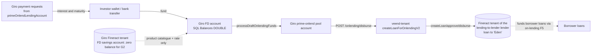

# D1.4 bill-payment-portal (Giro): Technical Assessment of the Fixed-Deposit Side

Repository: `quantinum/bill-payment-portal`, HEAD `25d8b550`. This repo is **Giro**: Veend's wallet, payments, cards and collections platform. It is the second consumer of the Fineract CBA, and it **owns the fixed-deposit (investment) product**, which is internally called *onlending loan accounts* or *loan subscriptions*. This document covers Giro only where it touches the CBA and fixed deposits. Wallet payments, cards and VAS are out of scope.

## 1. Technology stack

| Aspect | Finding | Evidence |
|---|---|---|
| Runtime | Node.js, CommonJS. Same API template lineage as veend-tenant and fineract-mod (GPL-3.0, same author) | [V] `package.json` |
| Data | MongoDB (accounts, users, `Primelogs`, products/payment requests) **and** a Sequelize SQL ledger (`Balances`, `Payments`, `Credits`, `Debits`) | [V] `models/Balances.js`, `models/Payments.js` |
| Money type in the SQL ledger | `balance: DOUBLE`, a floating-point type | [V] `models/Balances.js:17-18` |
| Queue | kue (`services/queue/{clock,workers,jobs}.js`). `jobs.js` is 10,360 lines | [V] |
| CBA client | `services/lendlot/index.js` (1,807 lines). A **separate fork** of veend-tenant's client, extended with savings, holds, transfers and interest posting | [V] |
| CBA tenant | A single Giro Fineract tenant from `config.CBABaseURL`, `CBATenantId`, `CBAUsername`, `CBAPassword`. It is **not** per lender. Unlike veend-tenant, there is no non-production tenant override | [V] `config/production.js:131-132`; `lendlot/index.js:46-52` |

## 2. What Giro uses Fineract for

| Use | Fineract objects | Status |
|---|---|---|
| **Customer mirror**: every Giro user becomes a Fineract client | `/clients` (`createBorrower`, via `jobs.createClient` `jobs.js:4645`) | Live. A fixer job runs every 10 min (`fixMissingClientId` `:4701`) |
| **Wallet savings account**: one per Giro account, savings product per currency (`CBASavingsProductId.NGN = 1`) | `/savingsaccounts` create → approve → activate (`createSavings` `lendlot:1588`; job `:4769`) | Live for account creation. **Balances were migrated off Fineract** to Giro's SQL ledger ("V3", `jobs.migrateBalance` `:7963`, which withdraws the Fineract balance and credits the local ledger) |
| Wallet liens | `?command=holdAmount` / `releaseAmount` on the wallet's Fineract savings account (`Liens.js:423, 485, 554`) | Live. The hold is placed on a Fineract account whose balance was migrated away [A: verify behaviour] |
| **Fixed deposits (investments)** | Fixed-term savings products keyed by tenure (`CBAFixedSavingsProductId`: 3→10, 6→12, 9→5, 12→6, 13→13, 2→11 "Oyster"), plus the product catalogue from `/savingsproducts`, and `nominalAnnualInterestRate` from the account | Live. Detail in §3 |
| Interest posting | `?command=postInterest` triggered by Giro jobs (`postInterest` `jobs.js:6255`, `postInterestOnUserAccounts` `:6498`) | Live for legacy accounts |
| Legacy on-lending funding loans | `createLoan` → `approveLoan` → `disburseLoan(…, disbursetosavings)` to `onlendingClientId`; `undodisbursal`; `getLoan` | Live code paths: `retryPendingOnlendingDisburseLoan` `jobs.js:7624-7740`; admin `closeLoans` `Internalteams.js:1355-1646`. The main path (`processLoanForOnlending`) is commented out "no longer supported" (`jobs.js:5590+`) |

## 3. The fixed-deposit product today ("loan subscriptions")

There are **three generations** in the code, all of which may still hold live balances:

| Generation | Flag | Where the money and interest live | Payout mechanics |
|---|---|---|---|
| G1: legacy Fineract FD | `isOnlending:true`, not `isCbaExclusive`, `isV3 != true` | **Fineract savings account** balance; interest via Fineract `postInterest` (triggered daily by Giro) | Daily `checkLoanAccount`. At maturity, or quarterly or monthly, Giro moves `availableBalance` or `totalInterestPosted` from the pool account to the investor's main wallet (`handleProductPurchase`). Fineract is **not** debited [V `jobs.js:5940-6003`, `6060-6090`] |
| G1 migration | `processOnlendingAccountsForMigration` → `checkOnlendingMigration` → `finishOnlendingMigration` (`jobs.js:8043-8160`) | Moves G1 balances to the local ledger by reading Fineract balances and the linked on-lending loans | In progress [A: how many G1 accounts remain] |
| **G2: current "CBA-exclusive"** (default for new accounts) | `isOnlending:true`, `isCbaExclusive:true` | **Not in Fineract.** Deposits land in the account's Giro SQL `Balances` row. Each funding becomes a Mongo `Primelogs` record. Interest is computed **on the fly** by `misc.aggregatePrimeOnlendData` (`services/misc/index.js:1392`). A Fineract FD savings account is still opened (`createFixedSavings` `jobs.js:5391`), but it receives no deposits or interest | Quarterly interest and maturity payouts are created as Giro **payment requests** from `primeOnlendLendingAccount` to the investor's main account (`jobs.js:5976-6050`, `6190+`). Payouts are recorded in `Accounts.interestPayouts[]` |

### 3.1 G2 lifecycle (verified)

1. **Create**: `POST …/accounts/:id/loan-subscription` → `AccountsController.createSubscriptionLoan` (`controllers/Accounts.js:1765`).
   - Inputs: `title`, `amount`, `tenure`, optional `productId`, `withdrawalFrequency ∈ {maturity, quarterly}` (forced to `maturity` for 3 months), `webhookURL`.
   - The product is validated against the Fineract savings product catalogue plus `CBAOnlendingActiveProductIds` (`misc.getOnlendingSavingsProducts`).
   - Minimum amount: ₦100,000, or ₦10,000 for tenure `'2'`.
   - Creates a Mongo `Accounts` doc with `isCbaExclusive:true` and `loanAmount`, `tenure`, `productId`, `hasExpired:false`. Opens the Fineract FD savings account and assigns a NUBAN-style account number for funding.
2. **Fund** (one or more transfers within a 3-day window): the account's SQL balance increases → `processLoanForOnlending` (`jobs.js:5417`) creates or updates a draft `Primelogs` record (`amount`, `purchaseIds[]`).
3. **Deploy**: `processDraftOnlendingFunds` (`jobs.js:9829`) checks that `balance ≥ loanAmount` and `primelog.amount == balance`. It then:
   - moves the balance to the **prime-onlend pool account** (`makePurchaseV2` → `onlenderPurchaseLog.cost`);
   - calls **veend-tenant** `POST /onlending/disburse` (`services/veendtenant/index.js:388`), which books a loan on the "lending-to-lender" tenant's Fineract to a synthetic borrower ("Eden") (`veend-tenant/controllers/Loans.js:2382` `createLoanForOnlendingV2`);
   - stores the returned `edenCbaLoanId` in `Accounts.loanIds[]`.
4. **Expire**: if the account is not fully funded within 3 days, it is marked `hasExpired`, with a notification and webhook (`checkLoanAccount` `jobs.js:5818-5830, 5865-5905`). [A] The refund path is not automated in the code read.
5. **Accrue** (computed, not posted): for each Primelog, `daily = round2(rate/100 × cost / 365)` and `earnings = daily × days(purchaseDate → today or maturity)`. The rate comes from the Fineract FD account's `nominalAnnualInterestRate` (`jobs.js:5844`, `misc:1392-1430`).
6. **Pay interest** (quarterly): when `days since createdAt % 90 == 0` and tenure > 3, a payment request for `totalEarnings − Σ interestPayouts` is created once per quarter (`interestPayouts[].quarter`).
7. **Mature**: when `createdAt + tenure months ≤ now` (or Fineract `status.matured`), a payment request for `deposits + earnings − paid interest` is created. The account is flagged `isCompleted` and `hasExpired`, and a `maturity` webhook is sent.
8. **Referral commission**: quarterly `payOnlendingReferralCommission` (`jobs.js:9956`).

### 3.2 How fixed deposits fund on-lending

**The fixed-deposit book is the funding side of the on-lending flow** documented in [D2.3 F5](../02-current-state/business-flows.md#f5-on-lending--prime-cross-tenant). The investor's deposit becomes a loan asset on a lender tenant, but neither CBA records the deposit liability or the interest expense for G2.

## 4. Strengths

- A clear product catalogue in the CBA (savings products with tenure and rate).
- Payout and maturity notifications plus webhooks for partners (`webhookURL`).
- Idempotency of quarterly payouts per account and quarter (`interestPayouts[].quarter`), and a deterministic maturity reference (`Onlending_${id}_${name}_maturity_withdrawal`).

## 5. Weaknesses and defects (verified)

| ID | Sev | Defect | Evidence |
|---|---|---|---|
| FD-01 | S1 | **No ledger for the G2 deposit liability or interest expense.** The deposit sits in a `DOUBLE` balance, then moves to a pool. Interest is computed on read and is never accrued in any GL | `isCbaExclusive:true` "treat as non cba transactional" (`Accounts.js:1829`); `aggregatePrimeOnlendData`; no `lendlot.deposit` caller anywhere |
| FD-02 | S1 | **Float money and per-day rounding drift.** `daily = (rate/100 × cost / 365).toFixed(2) * 1`, then multiplied by days. On ₦1,000,000 at 18%, the daily is 493.150… rounded to 493.15, so the error is up to ₦0.005 per day | `services/misc/index.js:1397-1405`; `Balances.balance DOUBLE` |
| FD-03 | S1 | **Tenure `'2'` is ambiguous.** The API message says "2 days", the minimum amount differs, but maturity is computed as `createdAt + 2 months` everywhere | `Accounts.js:1785-1793` vs `jobs.js:5841`, `6266`, `Users.js:5016` |
| FD-04 | S2 | **The quarterly payout trigger fires only on the exact day** (`dayDifference % 90 === 0`). If the daily job misses that day (outage, queue backlog), that quarter's payout is skipped until maturity. The "quarter" is also 90 days, not a calendar quarter | `jobs.js:5756-5780`; also `isMonthFromCreatedAt` |
| FD-05 | S2 | **Maturity uses JS `setMonth`** on `createdAt` (server timezone; Jan 31 + 1 month rolls to early March). Interest days use `moment.diff`. The maturity dates in different places can disagree | `jobs.js:5841` vs `processLoanForOnlending` `moment().add` |
| FD-06 | S2 | **The interest rate is read live from the Fineract account each day**, so a rate change on the product or account changes accrued earnings retroactively for all tranches | `jobs.js:5844` |
| FD-07 | S2 | **Monthly payout frequency** is supported in the model and jobs, but rejected by the create API. Legacy accounts may still carry it | `models/Accounts.js:198-202`; `Accounts.js:1768` |
| FD-08 | S2 | **G1 maturity payouts never debit Fineract.** Funds move pool → investor, so the Fineract FD balance stays and is reported as a liability | `handleProductPurchase(ourPoolAccount, …)` `jobs.js:5958` |
| FD-09 | S2 | A **partial-failure state** `disbursement_failed` after the pool debit succeeded has no automated compensation | `jobs.js:9930-9936` |
| FD-10 | S2 | **Holds placed on Fineract wallet accounts whose balances were migrated to the local ledger** | `Liens.js:400-425`; `jobs.migrateBalance` |
| FD-11 | S2 | **Secrets as config defaults** (third-party API keys and bearer tokens hard-coded as fallbacks) | `config/production.js` (values not reproduced) |
| FD-12 | S3 | A **third copy** of the Fineract client (veend-tenant, loandisk, Giro) with shared mutable `httpBody`, `Math.random`/`Date.now` references, and `Object.prototype` patching | `services/lendlot/index.js` |
| FD-13 | S3 | **Investor and on-lending linkage is held only in strings** (`loanIds: ['<loanId>_<purchaseId>']`), so there is no ledger link between deposits and funded loans | `models/Accounts.js:157`; `jobs.js:9924` |

## 6. Implications for Fineract-Mod

1. Fixed deposits move from "future" to **MVP scope** as a first-class module: [05-modules/fixed-deposits.md](../05-modules/fixed-deposits.md).
2. Giro becomes a **second CBA consumer**, with its own compat surface (savings endpoints). See [D2.7](../02-current-state/fixed-deposits-current-state.md#4-giro-cba-endpoint-inventory-compatibility-contract).
3. The deposit liability, accrued interest payable and interest expense must be **booked**, and linked to the on-lending funding they finance ([future/investor](../05-modules/future/investor.md) moves partly forward).
4. The Giro **wallet ledger** (V3 SQL balances) is a separate deposit-like ledger. Whether it moves into Fineract-Mod is an **open decision**; see [D6 §12](../07-migration-strategy.md#12-giro-fixed-deposit-migration).
