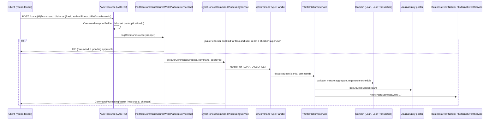

# D1.1 Apache Fineract: Technical Assessment

Repository: `quantinum/fineract`, HEAD `8e80aa6e85`. Fineract is the reference specification and test oracle for Fineract-Mod. This document records what it does, how it does it, and which parts are worth copying in design (not code).

## 1. Technology stack

| Aspect | Finding | Evidence |
|---|---|---|
| Language/runtime | Java 25 | [V] `build.gradle:421` (`JavaLanguageVersion.of(25)`) |
| Framework | Spring Boot 4.1.1, JAX-RS (Jersey) REST resources, JPA/EclipseLink, Spring Batch | [V] `build.gradle:116`; `*ApiResource` classes |
| Databases | MariaDB (default), MySQL, PostgreSQL | [V] `fineract-provider/build.gradle:217-221`, `docker-compose-{mariadb,mysql,postgresql}.yml` |
| Schema migrations | Liquibase: about 277 tenant changesets plus a tenant-store changelog | [V] `fineract-provider/src/main/resources/db/changelog/tenant/parts/0001_initial_schema.xml … 0275_*.xml` |
| Messaging | Kafka or JMS (ActiveMQ) for external events and remote batch partitioning | [V] `KafkaExternalEventProducer`, `JMSMultiExternalEventProducer`, `KafkaWorkerConfig` |
| Event schema | Avro (`MessageV1`, `BulkMessageV1`) | [V] `fineract-avro-schemas/src/main/avro/` |
| Packaging | Executable JAR (`bootJar`), Jib Docker image, WAR (`fineract-war`) | [V] `fineract-provider/build.gradle:329`, `build.gradle:342` |
| Size | About 7,100 Java files (provider 2,789; core 861; loan 695; working-capital-loan 592; savings 198; accounting 174) | [V] `find … -name '*.java' \| wc -l` per module |
| License | Apache License 2.0 | [V] `LICENSE_SOURCE`, `NOTICE_SOURCE` |

## 2. Module map

| Gradle module | Responsibility | Relevance to Fineract-Mod MVP |
|---|---|---|
| `fineract-core` | Command framework, tenants and data-source routing, business date, jobs, external events, users/roles/permissions, `GLAccount`, `LoanStatus` | **High**: platform patterns |
| `fineract-security` | Basic auth, OAuth2/OIDC, two-factor, tenant-aware filters | **High**: auth model |
| `fineract-command*` | New type-safe command pipeline (`CommandDispatcher`, hooks, JDBC `CommandStore`, audit, async, Disruptor) | **High**: cleaner command design than legacy `JsonCommand` |
| `fineract-loan` | Loan aggregate, handlers, cumulative schedule generators, classic repayment processors | **Critical** |
| `fineract-progressive-loan` (+ embeddable generator) | EMI/progressive schedules, `AdvancedPaymentScheduleTransactionProcessor`, `ProgressiveEMICalculator` | Medium: needed for declining-balance EMI, not for current flat products |
| `fineract-accounting` | Journal entries, product→GL mappings, GL closures, `AccountingProcessorHelper` | **Critical** |
| `fineract-cob` | COB framework (`COBBusinessStep`, `BatchBusinessStep`) | **High** |
| `fineract-charge`, `-tax`, `-rates` | Charge definitions, tax components, rates | High (charge); low (tax, rates) |
| `fineract-branch` | Offices/branches | Medium |
| `fineract-savings` | Savings, fixed and recurring deposits | Future |
| `fineract-investor` | External asset owners (loan sale/transfer) | Future (relevant to on-lending) |
| `fineract-working-capital-loan`, `fineract-loan-origination` | Working-capital product, originator tracking | Future |
| `fineract-document`, `fineract-report` | Documents, reporting | Medium |
| `fineract-provider` | Spring Boot app: API resources, most service implementations, loan COB steps, accounting processors, Liquibase | Reference for everything |
| `integration-tests`, `fineract-e2e-tests-*` | REST integration tests (652 files) and Cucumber features | **Very high**: scenario source for golden tests |
| `custom/*` | Extension modules (example `custom/acme/loan/cob`) | Shows Fineract's own extension pattern |

## 3. Request processing pipeline

Evidence:
- [V] Maker-checker branch: `fineract-core/.../commands/service/PortfolioCommandSourceWritePlatformServiceImpl.java:80` (`isMakerCheckerEnabledForTask && !currentUser.isCheckerSuperUser()`). Approval re-executes the command at `:98`/`:118`.
- [V] Loan state commands are dispatched in `LoansApiResource.java:688-698` (`reject`, `approve`, `disburse`, `undodisbursal`, `undoapproval`). `calculateLoanSchedule` is handled at `:576-585`.
- [V] Transaction commands are dispatched in `LoanTransactionsApiResource.java:578-616` (`repayment`, `waiveinterest`, `writeoff`, `undowriteoff`, `recoverypayment`, `foreclosure`, `chargeOff`, `reAge`, …).
- [V] The repayment path is `LoanWritePlatformServiceJpaRepositoryImpl.makeLoanRepayment` → `LoanAccountDomainServiceJpa.makeRepayment`. That method allocates through the repayment processor, re-processes accruals, saves the transaction, posts journals and fires `LoanBalanceChangedBusinessEvent`.
- [V] The command-source table `m_portfolio_command_source` stores every command, which gives Fineract its audit trail and maker-checker queue.

**Design lessons for Fineract-Mod [R]:**
- Keep the command abstraction: one command produces one audit record, can enter the maker-checker queue, runs in one DB transaction, and produces journals and events.
- Prefer the shape of the newer `fineract-command` (typed commands, hooks, a store) over legacy GSON `JsonCommand`.

## 4. Loan domain

| Concept | Class / table | Notes |
|---|---|---|
| Loan aggregate | `fineract-loan/.../loanaccount/domain/Loan.java` (1,883 lines) / `m_loan` | Holds status, terms, summary and derived balances |
| Transaction | `LoanTransaction` / `m_loan_transaction` | Typed by `LoanTransactionType`: DISBURSEMENT(1), REPAYMENT(2), WAIVE_INTEREST(4), REPAYMENT_AT_DISBURSEMENT(5), WRITEOFF(6), RECOVERY_REPAYMENT(8), WAIVE_CHARGES(9), ACCRUAL(10), REFUND(16), CHARGE_PAYMENT(17), CHARGE_OFF(27), and more ([V] `LoanTransactionType.java:26-78`) |
| Schedule | `LoanRepaymentScheduleInstallment` / `m_loan_repayment_schedule` | One row per installment with principal/interest/fee/penalty due, paid, waived and written off |
| Allocation map | `m_loan_transaction_repayment_schedule_mapping` | Records which installment components each transaction paid |
| Loan status | `LoanStatus` | 100 submitted, 200 approved, 300 active, 400 withdrawn, 500 rejected, 600 closed (obligations met), 601 written off, 602 closed (rescheduled), 700 overpaid ([V] `fineract-core/.../LoanStatus.java:28-39`) |
| Product | `LoanProduct` / `m_product_loan` (+ `_charge`, `_variations_borrower_cycle`, `_recalculation_details`, …) | |
| Interest method | `InterestMethod` | DECLINING_BALANCE(0), FLAT(1) ([V] `InterestMethod.java:23-25`) |
| Schedule generators | `CumulativeFlatInterestLoanScheduleGenerator`, `CumulativeDecliningBalanceInterestLoanScheduleGenerator`, `ProgressiveLoanScheduleGenerator` | |
| Allocation strategies | `transactionprocessor/impl/*`: `mifos-standard-strategy` (Penalties, Fees, Interest, Principal), Heavens Family, Creocore, RBI, Early Payment, Principal-Interest-Penalty-Fees, Interest-Principal-Penalty-Fees, and two "due vs. in-advance" variants. `AdvancedPaymentScheduleTransactionProcessor` is configurable | [V] `STRATEGY_CODE` constants in each class |
| Locking | `m_loan_account_locks` | Per-loan lock used by COB and inline COB |
| Top-up | `m_loan_topup` | Not used by veend-tenant (see D2) |
| Delinquency | `m_loan_delinquency_tag_history`, `m_loan_arrears_aging` | |
| Reschedule | `m_loan_reschedule_request`, `m_loan_term_variations` | |

## 5. Accounting

- **GL accounts** (`acc_gl_account`, `GLAccount`) have types ASSET(1), LIABILITY(2), EQUITY(3), INCOME(4) and EXPENSE(5) ([V] `GLAccountType.java:25-29`).
- **Journal entries** (`acc_gl_journal_entry`, `JournalEntry`) are single-sided rows with `type` CREDIT(1) or DEBIT(2) ([V] `JournalEntryType.java:23-24`), grouped by `transaction_id`.
- **Accounting rules** per product: NONE(1), CASH_BASED(2), ACCRUAL_PERIODIC(3), ACCRUAL_UPFRONT(4) ([V] `AccountingRuleType.java:30-33`).
- **Product→GL mapping** (`acc_product_mapping`, `ProductToGLAccountMapping`) maps roles to GL accounts, configured on the loan product through parameters such as `fundSourceAccountId`, `loanPortfolioAccountId`, `interestOnLoanAccountId`, `receivableInterestAccountId`, … ([V] `AccountingConstants.LoanProductAccountingParams`, `:156+`).
- **Processor selection:** `AccountingProcessorForLoanFactory` picks `CashBasedAccountingProcessorForLoan` (1,014 lines) or `AccrualBasedAccountingProcessorForLoan` (2,242 lines).

Accrual-based postings ([V] `AccrualBasedAccountingProcessorForLoan.java`):

| Event | Debit | Credit | Ref |
|---|---|---|---|
| Disbursement | LOAN_PORTFOLIO (principal) | FUND_SOURCE | `createJournalEntriesForDisbursements` `:1309` |
| Accrual | INTEREST/FEES/PENALTIES_RECEIVABLE | INTEREST_ON_LOANS / INCOME_FROM_FEES / INCOME_FROM_PENALTIES | `createJournalEntriesForAccruals` `:2015` |
| Repayment | FUND_SOURCE | LOAN_PORTFOLIO (principal), *_RECEIVABLE (interest, fee, penalty), OVERPAYMENT (excess) | `createJournalEntriesForLoanRepayments` `:1695` |
| Repayment at disbursement (upfront fee) | FUND_SOURCE | INCOME_FROM_FEES directly | same, `isIncomeFromFee` branch |
| Write-off / waivers | LOSSES_WRITTEN_OFF (or income for waivers) | LOAN_PORTFOLIO / receivables | `createJournalEntriesForWriteOffs` `:1379` |
| Recovery after write-off | FUND_SOURCE | INCOME_FROM_RECOVERY | `:1983` |
| Reversal | Mirror of the original entries | | `createJournalEntryForReversedLoanTransaction`, called at `:69` |

Other accounting points:
- GL closures are enforced per office before posting: `helper.checkForBranchClosures(latestGLClosure, transactionDate)` at `:65`.
- Provisioning is handled by `ProvisioningEntry` and `ProvisioningEntriesWritePlatformServiceJpaRepositoryImpl`, with criteria in `m_provisioning_criteria*` and `m_loanproduct_provisioning_*`.

**Lesson [R]:** Fineract's role-based mapping (a product maps a role to a GL account) is the right abstraction. Fineract-Mod should keep the **same role vocabulary**, so that migrated `acc_product_mapping` rows map one-to-one.

## 6. Multi-tenancy

- **Tenant resolution:** the `Fineract-Platform-TenantId` header, with `tenantIdentifier` as a query-parameter fallback ([V] `fineract-security/.../TenantAwareBasicAuthenticationFilter.java:70,113-116`).
- **Tenant store:** a separate DB holding tenant connection details (`JdbcTenantDetailsService`; changelog `tenant-store/`).
- **Isolation:** **one database per tenant**, routed by `RoutingDataSource` + `DataSourcePerTenantServiceFactory` + `TomcatJdbcDataSourcePerTenantService`. The current tenant is held in `ThreadLocalContextUtil`.
- **Assessment:** isolation is strong, but this costs a connection pool per tenant and N migrations per release. At Veend's scale, with one tenant per lender, this has operational cost. See [ADR-003](../04-target-architecture/adr/ADR-003-tenancy-model.md).

## 7. Security

- **Basic auth** is on by default (`fineract.security.basicauth.enabled`). **OAuth2** is off by default, with an embedded authorization server and a JWT resource-server option ([V] `application.properties:24-25`; `SecurityConfig`, `AuthorizationServerConfig`, `OidcFederationSecurityConfig`).
- **Two-factor:** `TwoFactorAuthenticationFilter`, `TwoFactorServiceImpl`.
- **RBAC:** `AppUser` → `Role` → `Permission` (`m_appuser`, `m_role`, `m_permission`). Permission codes follow `ACTION_ENTITY` (for example `DISBURSE_LOAN`, `REPAYMENT_LOAN`), with `_CHECKER` variants for maker-checker.
- **Gap:** Basic auth with long-lived credentials is how veend-tenant connects (D2). There is no per-request service identity and no scoped tokens.

## 8. COB, business date, jobs and events

- **Business date:** `m_business_date` (BUSINESS_DATE, COB_DATE), `BusinessDateReadPlatformServiceImpl`.
- **Loan COB:** a Spring Batch manager/worker with partitioning (`LoanCOBManagerConfiguration`, `LoanCOBWorkerConfiguration`, `LoanCOBPartitioner`). The steps include:
  - `CheckLoanRepaymentDue`, `CheckLoanRepaymentOverdue`, `CheckDueInstallments`
  - `UpdateLoanArrearsAging`, `SetLoanDelinquencyTags`, `ApplyChargeToOverdueLoans`
  - `AddPeriodicAccrualEntriesBusinessStep`, `AccrualActivityPostingBusinessStep`, `LoanInterestRecalculationCOBBusinessStep`
  - `CapitalizedIncomeAmortizationBusinessStep`, `BuyDownFeeAmortizationBusinessStep`
  - `LoanAccountOwnerTransferBusinessStep` (investor)
- **Inline COB:** `InlineLoanCOBExecutorServiceImpl` brings a loan up to date before a transaction if it lagged behind.
- **Node roles:** `fineract.mode.read/write/batch-worker/batch-manager-enabled` ([V] `application.properties:83-86`).
- **External events:** transactional outbox (`m_external_event`), sent by `SendAsynchronousEventsTasklet` to Kafka or JMS as Avro. Per-event enablement comes from `m_external_event_configuration`.

**Lesson [R]:** Copy the **outbox** and **business-date** concepts as they are. Simplify COB to a Bull-based partitioned job runner, because Spring Batch is unnecessary at our volume.

## 9. Reporting and extensibility

- **Stretchy reports:** reports are SQL-defined in `stretchy_report` and `stretchy_parameter`, and run via `GET /runreports/{name}` (`RunreportsApiResource`). veend-tenant uses `ActiveLoansSummary` and `Aging Detail`.
- **Datatables:** custom extension tables are registered in `x_registered_table`, with CRUD via `DatatablesApiResource`. veend-tenant uses `userdata` (email) and `loandata` (loanReason, channel, remitaMandateReference).
- **Search:** `SearchApiResource` (`/search?resource=clients,...`).

## 10. Testing and deployment

- **Unit tests** in each module. **Integration tests:** `integration-tests/` (652 files) drive a running server over REST. **Cucumber E2E:** `fineract-e2e-tests-runner/src/test/resources/features/` (`Loan-Part*.feature`, `COB.feature`, `EMICalculation-*.feature`, `LoanChargeOff-*.feature`, …).
- **Testcontainers** (PostgreSQL) in provider tests.
- **Deployment:** many docker-compose variants plus `kubernetes/` manifests.

**Lesson [R]:** The Cucumber features are the **best available executable specification** of Fineract loan semantics. P2–P4 golden tests should port the scenarios that match our product configurations.

## 11. Strengths and limitations (for our purposes)

| Strengths | Limitations |
|---|---|
| Mature, battle-tested loan and accounting semantics | Very large: about 7,100 Java files, most of which we don't use |
| Full maker-checker and command audit | Legacy `JsonCommand`/GSON pipeline; business logic spread across the provider |
| Outbox events and Avro schemas | Java 25 / Spring Boot 4 skills gap in Veend's Node team |
| Configurable allocation strategies and accounting rules | DB-per-tenant operational overhead |
| Strong test corpus (integration + Cucumber) | Datatables and stretchy reports are runtime-SQL and hard to version-control |
| Apache 2.0, permissive | Upgrade churn: 277 changesets; frequent breaking API changes in loan modules |

## 12. Licensing obligations for Fineract-Mod

The approach is a clean-room TypeScript reimplementation that reads Fineract code to learn its behaviour.
- [R] Copying **ideas, semantics, enum vocabularies and test scenarios** creates no redistribution obligation. Apache 2.0 also permits code reuse.
- [R] If any **file, SQL report or test fixture** is copied verbatim:
  1. keep the Apache license header,
  2. add `LICENSE` and Fineract's `NOTICE` text ("Apache Fineract — Copyright 2008-2026 The Apache Software Foundation") to a `THIRD_PARTY_NOTICES.md` in fineract-mod,
  3. mark the file as modified.
- [R] Do not use "Apache" or "Fineract" as part of the product's trade name in external marketing. "Fineract-Mod" is acceptable as an internal codename only. [A] Legal should confirm the external product name.
- [V] fineract-mod's own template is **GPL-3.0** (`fineract-mod/package.json` `license`). Before any distribution outside Veend, confirm whether a GPL-3.0 framework base is acceptable for a proprietary CBA. Internal SaaS use generally does not trigger GPL distribution obligations. **[A] Legal review required (see risk R-OPS-05).**
