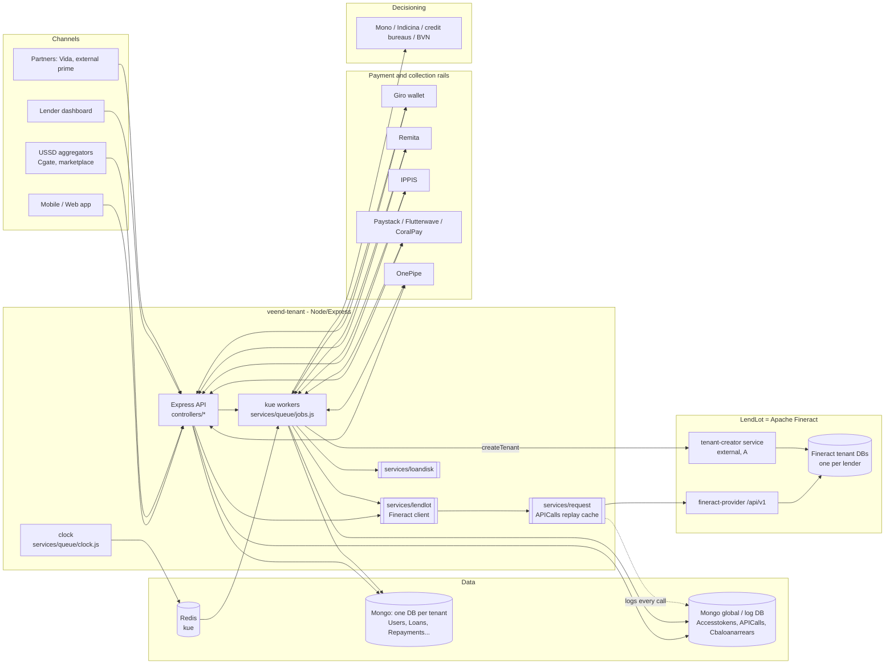
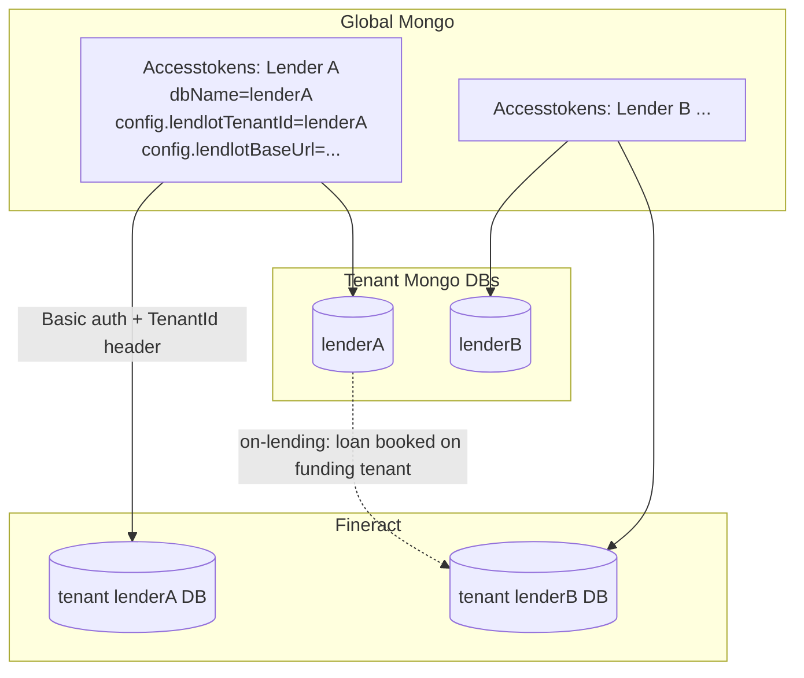
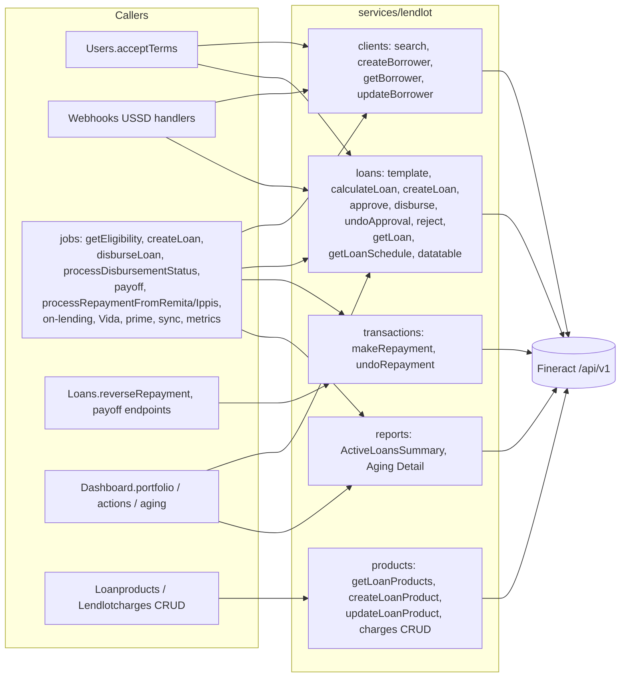

# D2.1 Current-State Architecture

How veend-tenant uses Apache Fineract (LendLot) today. Every element below was verified in code unless tagged otherwise.

## 1. System context

Key facts:
- [V] All CBA traffic goes through **one class**, `services/lendlot/index.js`, which in turn uses `services/request`.
- [V] **There are two systems of record for balances.** Fineract holds the authoritative schedule and transactions. veend-tenant `Loans` keeps a float-arithmetic **mirror** (`totalOutstanding`, `totalRepayment`, `status`) that drives user-facing behaviour.
- [V] Money movement (disbursement and collection) happens **outside** the CBA, through Giro, Remita, IPPIS, card processors and OnePipe. The CBA is told afterwards.

## 2. Tenant → Fineract mapping

- [V] `services/passport` merges `Accesstokens.config` into `req.config`, and `clock.js` merges it into each job's `data.config`. Each `new Lendlot(...)` gets that tenant's credentials.
- [V] Outside production, every tenant is routed to the Fineract tenant `veendhqautolending` (`lendlot/index.js:45`), so staging cannot test multi-tenant isolation.
- [V] There is no office hierarchy: `officeId=1` everywhere.
- [V] **Cross-tenant on-lending:** `processOnLendingLoan` (`jobs.js:8369`) picks a funding lender by `Accesstokens.lastBalance` / `lastPrimeDisbursementAccountBalance` and creates a hidden "onlending" product on *that* lender's tenant. It then books client and loan there and links them through `Loans.onlenderLoanId` and `onlenderAccessToken`.

## 3. Integration architecture (CBA boundary)

The [endpoint inventory](lendlot-endpoint-inventory.md) is the authoritative list: 23 live methods covering about 25 distinct endpoint shapes.

## 4. Runtime topology

| Process | Entry | Fineract usage |
|---|---|---|
| API (`npm start`) | `app.js` | Synchronous calls inside request handlers. `acceptTerms` blocks on create → approve → get |
| Workers (`npm run workers`) | `services/queue/workers.js` | Most CBA writes: disbursement confirmation, all repayments, on-lending, Vida |
| Clock (`npm run clock`) | `services/queue/clock.js` | Enqueues cron jobs from DB rows (`requeryDisbursement`, `pushRepayments`, `*Repayment` hourly sweeps, `checkOverdueTenureLoans`, `updateMetrics`, …) |
| LendLot | Fineract `fineract-provider` behind `cba.veendhq.com:8443` ([V] `veendTenant*.yml` `TENANT_URL`) | System of record for loans and GL |

[A] Fineract's version, deployment topology, DB engine, COB/job schedule and maker-checker settings in production are **not** visible in these repos. They must be captured from the running LendLot instance before migration planning is final. See [D6 §2](../07-migration-strategy.md#2-pre-migration-discovery-on-the-live-lendlot).
