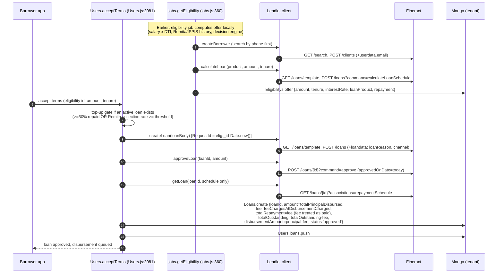
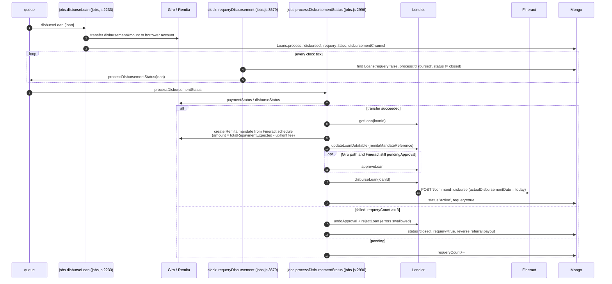
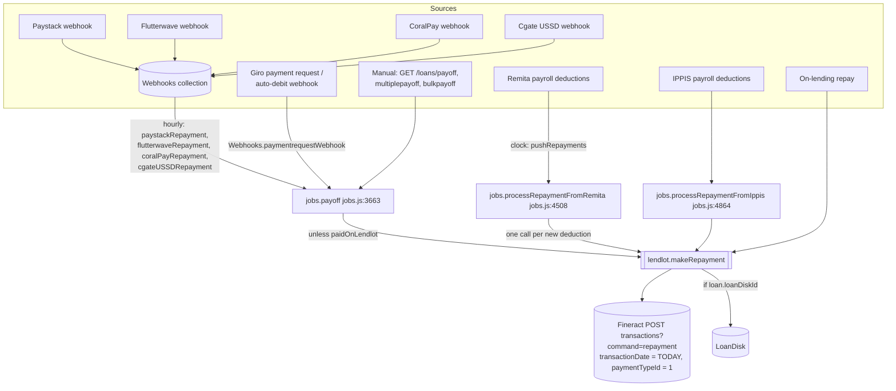
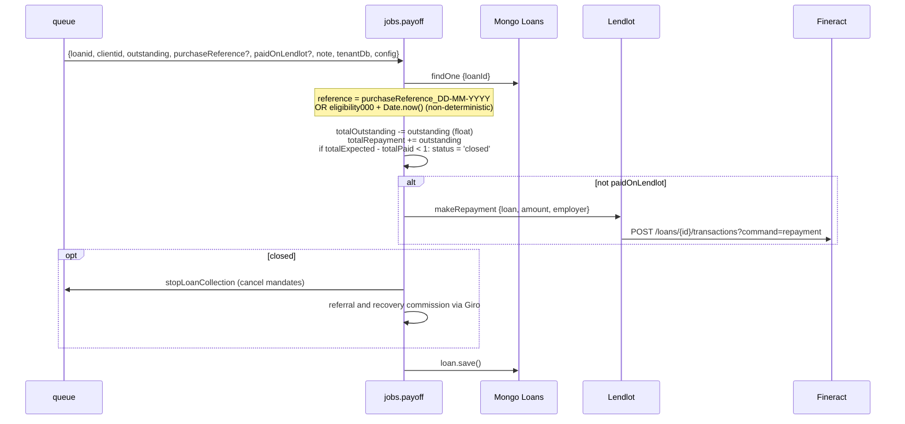
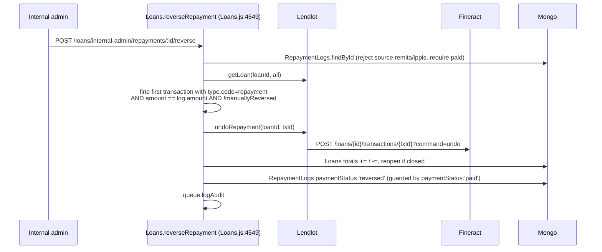
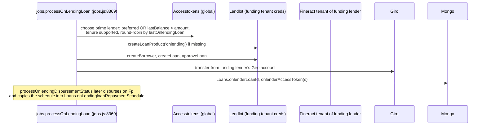

# D2.3 Critical Business Flows (current state)

Sequence diagrams of the flows that touch the CBA. Function names and line references are from `veend-tenant` ([V] unless tagged).

## F1. Eligibility → application → approval (app channel)

Observations:
- [V] Application and approval happen in one synchronous step: no human approval, no maker-checker.
- [V] The **upfront fee is netted from the disbursement** (`disbursementAmount = totalPrincipalDisbursed - feeChargesAtDisbursementCharged`). Locally it is counted as already repaid. In Fineract it is a disbursement-time charge.
- [V] **Top-ups are not real top-ups.** `acceptTerms` marks the local loan `isTopup` but creates a second, independent Fineract loan. `isTopup/loanIdToClose` is commented out (`Users.js:2191-2196`), and so is the `loanToClose` link (`:2272`). `Users.disburseLoan` (`:2373-2387`) has net-off logic (`disbursementAmount -= prevLoan.totalOutstanding`), but it only runs when `loanToClose` is set, and nothing sets it today. In effect the borrower ends up with **two concurrent loans**. [A] Operations should confirm this is the intended behaviour (see DF-07).
- USSD variants (`Webhooks.ussd`, `shortUssd`, `shortVerificationUssd`, `shortEmployerVerificationUssd`, `shortUssdDropoff`) repeat this sequence inline.

## F2. Disbursement, requery and failure

Observations:
- [V] The Fineract `actualDisbursementDate` is the date the **requery confirmed** the transfer, not the date the money moved. If the requery runs late, interest accrual and due dates shift.
- [V] There is no `undodisbursal` path. If a transfer is reversed after Fineract disbursement, nothing corrects the CBA.
- [V] `undoApproval`/`rejectLoan` swallow errors (`{isError:true}`). A failed reject leaves an *approved* loan in Fineract while the local copy is `closed`.

## F3. Repayment: all channels funnel into `makeRepayment`

`jobs.payoff` detail ([V] `jobs.js:3663-3828`):

Observations:
- [V] **Ordering hazard.** Local totals are computed first, then the CBA call is made, then `loan.save()` runs.
  - If the CBA call throws, nothing is saved locally. That is correct.
  - If `save()` fails after a successful CBA post, the job retries with a **new** `Date.now()` reference, so Fineract is posted **twice**.
- [V] Closure uses a **local** float comparison (`< 1` naira tolerance). Fineract decides closure independently.
- [V] Remita deductions are filtered to `paymentstatus === 'paid'` and **at least 2 days old**. Each is posted with RequestId `${loanId}_${deductiondate}`, which is deterministic and replay-safe, but `transactionDate` is still today.

## F4. Repayment reversal

Observations:
- [V] The Fineract transaction is matched **by amount only**. Two equal repayments are ambiguous, so the wrong one may be reversed.
- [V] The "already reversed" guard runs **after** the Fineract undo. Two concurrent requests can both call undo (on different equal-amount transactions).

## F5. On-lending / prime (cross-tenant)

- [V] The same borrower loan therefore exists **twice**: in the originating tenant's CBA and in the funder's CBA, with independent schedules and no ledger link between them.
- [R] In Fineract-Mod this becomes an explicit **inter-tenant participation / loan-sale** construct. See [05-modules/future/investor.md](../05-modules/future/investor.md) and ADR-003.

## F6. Vida BNPL booking

- [V] Webhook → `logPendingVidaBnplLoansOnCba` (`jobs.js:16127`) claims the record atomically (`bookingStatus ∈ {pending, failed}` and `cbaLoanId: null`). It persists `cbaLoanId` **immediately after create**, before approve and disburse. `reconcileVidaBnplBooking` (`:16681`) completes partially booked loans ([V] `docs/vida/overview.md:99-105, 216-220`).
- [V] Vida repayments (`loan.repayment.success`) are acknowledged but **not posted to the CBA** ([V] `docs/vida/overview.md:308`).
- [V] Management fees are "recorded only, never charged on the CBA" (`overview.md:167`).

This flow is the best existing pattern for exactly-once booking. Fineract-Mod should make it the **default**, using server-side idempotency keys ([R]).

## F7. Write-off, default and insurance (local only)

- [V] `jobs.writeOffLoan` (`jobs.js:13548`) sets `isWriteOff`, `writeOffDate` and `writeOffBy` on the Mongo loan. **No CBA call.**
- [V] `sweepLoanDefaults` / `markLoanDefaulted` set `isDefaulted`, `daysOverdue` and `missedRepaymentCount` locally.
- [V] `jobs.insuranceClaimed` records the claim locally.
- Consequence: Fineract keeps the loan **active**, accruing interest under accrual accounting, and reports it in the portfolio. The GL never recognises the loss or the insurance recovery.

## F8. Product and charge administration

- [V] `Loanproducts.create` → `createLoanProduct` creates the product on the CBA with hard-coded accounting (ACCRUAL_UPFRONT, flat interest, fixed GL ids 5/9/30/32/31/24/6/10/7/8/19/33), then stores `externalId` locally.
- [V] `Lendlotcharges.create/updateOne/deleteOne` → charges CRUD. The local `lendlotChargeId` is stored.
- [V] The hard-coded GL ids only work if every tenant's chart of accounts was created with identical ids. [A] This presumably comes from the tenant-creator seed.
