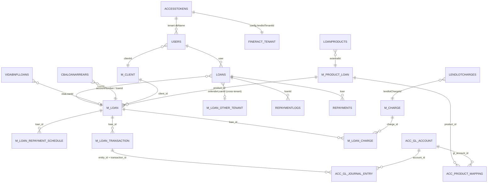

# D2.4 Data Model and Cross-System Relationships

## 1. veend-tenant (MongoDB) ↔ Fineract identifiers

[V] Field lists below are taken from `veend-tenant/models/*.js`.

| veend-tenant collection | Field holding a CBA id | Fineract entity | Notes |
|---|---|---|---|
| `Users` (tenant DB) | `clientId` | `m_client.id` | Set by `jobs.createClient` / `getEligibility` |
| `Loans` (tenant DB) | `loanId` | `m_loan.id` | **Primary join key everywhere** (string). `edenLoanId` duplicates it in `acceptTerms` |
| `Loans` | `onlenderLoanId`, `onlenderLoanIds[]`, `onlenderAccessToken(s)` | `m_loan.id` in **another tenant's** Fineract | On-lending link (by Mongo `_id` of the loan doc plus Accesstokens) |
| `Loans` | `primeLenderOriginalLoanId` | originating loan | External prime |
| `Loanproducts` | `externalId` | `m_product_loan.id` | |
| `Lendlotcharges` | `lendlotChargeId` | `m_charge.id` | |
| `VidaBnplLoans` | `cbaLoanId` | `m_loan.id` | Set before approve/disburse ("book at most once") |
| `Cbaloanarrears` (**global**) | `accountNumber`, `loanId` | `m_loan.account_no`, `m_loan.id` | Snapshot of the Aging Detail report |
| `RepaymentLogs` | `loanId`, `purchaseReference` | none (no Fineract tx id stored) | **The Fineract transaction id is never stored**, which is why reversals match by amount |
| `APICalls` (log DB) | `RequestId`, `service`, `response` | n/a | Replay cache and integration log |
| Fineract datatable `loandata` | `remitaMandateReference`, `loanReason`, `channel` | `loandata` (custom) | Written via `/datatables/loandata/{loanId}` |
| Fineract datatable `userdata` | `email` | `userdata` (custom) | Written on client create/update |

## 2. Local `Loans` document: CBA-mirrored vs. local-only fields

[V] `models/Loans.js` (about 100 fields).

| Category | Fields |
|---|---|
| Mirrored from the CBA at booking | `amount`, `fee`, `instalmentFee`, `interestRate`, `interestAmount`, `totalExpectedRepayment`, `repaymentAmount`, `disbursementAmount`, `onLendingloanRepaymentSchedule` |
| Mirrored and then **mutated locally with floats** | `totalRepayment`, `totalOutstanding`, `status` (`approved/active/closed`), `lastInstallmentDate`, `repaymentDate` |
| Local lifecycle | `process`, `disbursementStatus`, `disbursementChannel`, `disbursementAccountNumber/BankCode`, `requery`, `requeryCount`, `disburseDate` |
| Collections | `remitaMandateReference`, `restructuredRemitaMandateReferences`, `recreateMandate`, `remitaRepayments`, `ippisRepayments`, `recoveryMandate(s)`, `allMandatesSetup`, `mandateRetryCount`, `repaymentInvoices` |
| Credit risk (local only) | `isDefaulted`, `defaultedAt`, `missedRepaymentCount`, `daysOverdue`, `isWriteOff`, `writeOffDate`, `writeOffBy`, `isInsuranceClaimed`, `insuranceClaimed*` |
| Commercial | `referral*`, `recoveryAgent*`, `isViaReferral`, `isReferralActive` |
| Product variants | `isTopup`, `loanToClose`, `isLoanCyclic`, `totalNumberOfCycles`, `currentCycleCount`, `cyclicLoanHistory`, `isVidaBnpl`, `vidaLoanId`, `isVidaPrime`, `isIppis`, `ippisLoanId`, `bnplId`, `purchaseId` |

## 3. ER diagram: current cross-system relationships

## 4. Fineract core tables in scope for migration

[V] Table names come from `fineract-provider/src/main/resources/db/changelog/tenant/parts/*.xml` (`createTable`).

| Domain | Tables |
|---|---|
| Organisation | `m_office`, `m_staff`, `m_currency`, `m_organisation_currency`, `m_holiday`, `m_holiday_office`, `m_working_days`, `m_payment_type`, `m_payment_detail` |
| Users/security | `m_appuser`, `m_role`, `m_permission` (+ join tables), `m_portfolio_command_source` |
| Clients | `m_client` (+ datatable `userdata`), `m_note` |
| Products | `m_product_loan`, `m_product_loan_charge`, `m_product_loan_configurable_attributes`, `m_product_loan_variations_borrower_cycle`, `m_product_loan_recalculation_details` |
| Charges | `m_charge`, `m_loan_charge`, `m_loan_installment_charge`, `m_loan_charge_paid_by`, `m_loan_overdue_installment_charge` |
| Loans | `m_loan`, `m_loan_repayment_schedule`, `m_loan_repayment_schedule_history`, `m_loan_transaction`, `m_loan_transaction_repayment_schedule_mapping`, `m_loan_transaction_relation`, `m_loan_disbursement_detail`, `m_loan_approved_amount_history`, `m_loan_arrears_aging`, `m_loan_delinquency_tag_history`, `m_loan_topup`, `m_loan_account_locks` (+ datatable `loandata`) |
| Accounting | `acc_gl_account`, `acc_gl_journal_entry`, `acc_product_mapping`, `acc_gl_closure`, `acc_gl_financial_activity_account`, `acc_accounting_rule` |
| Provisioning | `m_provision_category`, `m_provisioning_criteria`, `m_provisioning_criteria_definition`, `m_loanproduct_provisioning_mapping`, `m_loanproduct_provisioning_entry`, `m_provisioning_history` |
| Platform | `c_configuration`, `m_business_date`, `job`, `job_run_history`, `m_external_event`, `stretchy_report`, `stretchy_parameter`, `x_registered_table` |

## 5. Data-quality hazards found

| # | Hazard | Evidence |
|---|---|---|
| DQ-1 | The local balance mirror is float-mutated and can diverge from Fineract | [V] `jobs.js:3695-3699`; `Loans.js:4587-4588` |
| DQ-2 | The Fineract transaction id is not stored for repayments, so reversals match by amount | [V] `Loans.reverseRepayment` |
| DQ-3 | `Cbaloanarrears` is a **global** collection keyed by `accountNumber`. Account numbers are only unique per Fineract tenant, so two tenants can collide | [V] `models.Cbaloanarrears.global()` at `jobs.js:11111` |
| DQ-4 | Write-off and default exist only locally | [V] `jobs.writeOffLoan` |
| DQ-5 | Fineract datatables hold business data (`remitaMandateReference`) also stored on `Loans` | [V] |
| DQ-6 | Non-production environments share one Fineract tenant, so test data from all tenants is mixed | [V] `lendlot/index.js:45` |
