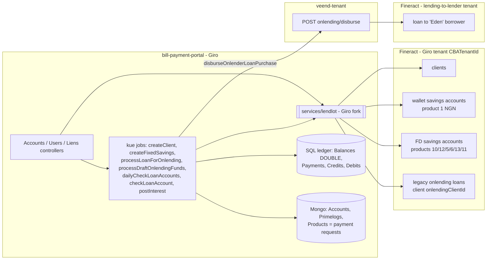
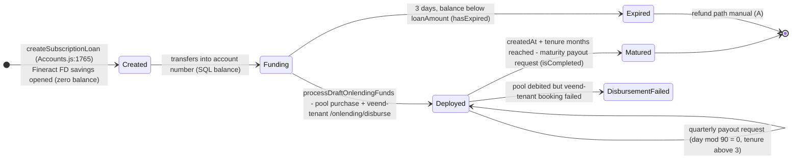

# D2.7 Fixed Deposits and Giro: Current-State Architecture

Covers how `bill-payment-portal` (Giro) runs the fixed-deposit (FD) product and uses Fineract. Assessment: [D1.4](../01-assessment/bill-payment-portal.md). All facts are [V] in `bill-payment-portal` unless tagged.

## 1. System context (FD view)



## 2. FD account lifecycle (G2, current product)



## 3. Money and record flow

| Event | Real money | Giro records | Fineract (Giro tenant) | Fineract (lender tenant) |
|---|---|---|---|---|
| Fund FD | Investor → FD account number | SQL `Balances.balance += amount` (DOUBLE); `Primelogs` draft | **None** (G2) | — |
| Deploy | FD account → prime-onlend pool | SQL debit/credit via `makePurchaseV2`; `Primelogs.onlenderPurchaseLog` | **None** | `createLoanForOnlendingV2`: loan to "Eden" (create, approve, disburse) |
| Accrue interest | — | **Not stored.** Computed on read (`aggregatePrimeOnlendData`) | **None** | Eden loan accrues interest on the lender's book |
| Quarterly payout | `primeOnlendLendingAccount` → investor main wallet | Payment request (`Products`), `Accounts.interestPayouts[]` | **None** | [A] Is the Eden loan repaid in step? |
| Maturity | Same, deposits + earnings − paid interest | Payment request; `isCompleted` | **None**; FD account left open | [A] Eden loan repayment |
| G1 (legacy) interest | — | `interestPostingDate` | `postInterest` posts to the FD savings account | — |
| G1 maturity | Pool → investor | `handleProductPurchase` | **Not debited** (FD-08) | — |

**Net effect.** For current (G2) deposits, there is **no general-ledger record anywhere** of:
- the deposit liability to the investor;
- the interest expense accruing on it;
- the payable at maturity;
- the funding receivable from the lender tenant.

These amounts exist only as Mongo documents, a `DOUBLE` balance column, and arithmetic performed at read time.

## 4. Giro CBA endpoint inventory (compatibility contract)

Source: `bill-payment-portal/services/lendlot/index.js`. Live callers come from grep over `controllers/`, `services/queue/`, `services/misc/` (excluding the client itself).

| # | Fineract endpoint | Client method | Live callers | Fields consumed |
|---|---|---|---|---|
| G-C1 | `GET /search` + `POST /clients` (with `savingsProductId`, which opens the wallet savings account in the same call) | `createBorrower` | `jobs.createClient` (`jobs.js:4656`) | `clientId`, `savingsId`; error `"Client already exists"` + `id` |
| G-S1 | `POST /savingsaccounts` then `?command=approve` then `?command=activate` | `createSavings` (`lendlot:1588`) | `jobs.createSavings` (`:4776`), `createFixedSavings` (`:5398`), `workers.js:457` | `savingsId` |
| G-S2 | `GET /savingsproducts` | `getSavingsProducts` | `misc.getOnlendingSavingsProducts` (`misc:1101`) → create API and catalogue | `id, name, nominalAnnualInterestRate, lockinPeriodFrequency, …` |
| G-S3 | `GET /savingsaccounts/{id}?associations=all\|transactions` | `getSavingsAccountDetails` | `Accounts.js:1909, 2084`; `jobs.js:5834, 6260` | `summary.{accountBalance, availableBalance, totalInterestPosted}`, `nominalAnnualInterestRate`, `status.matured`, `transactions[]` |
| G-S4 | `GET /savingsaccounts/{id}/transactions/{txId}` | `getSavingsAccountSingleTransaction` | `Accounts.js:2118` | transaction object |
| G-S5 | `GET /savingsaccounts/{id}` | `getSavingsAccount` | migration jobs (`jobs.js:7972, 8143`) | `summary.availableBalance` |
| G-S6 | `POST /savingsaccounts/{id}?command=postInterest` | `postInterest` | `jobs.postInterest` (`:6286`), `workers.js:628` | presence = success |
| G-S7 | `POST /savingsaccounts/{id}/transactions?command=withdrawal` | `withdraw` | `jobs.migrateBalance` (`:7989`) only | — |
| G-S8 | `POST /savingsaccounts/{id}/transactions?command=holdAmount` | `placeLienOnAccount` | `Liens.js:423` | `resourceId`, `id` |
| G-S9 | `POST /savingsaccounts/{id}/transactions/{txId}?command=releaseAmount` | `debitLien` | `Liens.js:485, 554` | — |
| G-C2 | `GET /clients/{id}/accounts` | `getClientSavingsAccounts` | `Users.js:5000` | `savingsAccounts[].{id, productId, productName}` |
| G-L1 | `POST /loans`, `?command=approve`, `?command=disbursetosavings` | `createLoan`, `approveLoan`, `disburseLoan(…, true)` | `retryPendingOnlendingDisburseLoan` (`jobs.js:7689-7739`) (legacy on-lending) | `loanId` |
| G-L2 | `GET /loans/{id}?associations=…` | `getLoan`, `getLoanRepayment` | `Internalteams.js:1355, 1591`; `jobs.js:8100`; migration | `status.active`, `principal`, schedule |
| G-L3 | `POST /loans/{id}?command=undodisbursal` | `undoDisbursal` | `Internalteams.js:1359-1646` (admin `closeLoans`) | — |
| — | `/accounttransfers`, `?command=deposit` | `accountTransfer`, `deposit` | **No live callers** | — |

The Giro tenant is configured globally (`config.CBABaseURL`, `CBATenantId`), not per lender ([V] `config/production.js:131-132`).

## 5. Interest and maturity formulas in use (G2)

[V] `services/misc/index.js:1392-1430`, `services/queue/jobs.js:5756-5780, 5841-5844`:

```
rate          = FD savings account nominalAnnualInterestRate   (read live, daily)
for each Primelog p with onlenderPurchaseLog.cost:
    daily_p   = round2( rate/100 × cost_p / 365 )               (JS float, toFixed(2))
    current_p = daily_p × days(p.purchasedAt, today)
    expected_p= daily_p × days(p.purchasedAt, maturity)
maturity      = createdAt.setMonth(createdAt.getMonth() + tenureMonths)   (tenure '2' also treated as months)
deposits      = Σ cost_p ;  earnings = Σ current_p
quarter due   = floor(daysSinceCreated / 90) when daysSinceCreated mod 90 == 0 and tenure above 3
interest due  = earnings − Σ interestPayouts.paidAmount
maturity pay  = deposits + earnings − Σ interestPayouts.paidAmount
```

This amounts to **simple interest, Actual/365, accrued from each tranche's deployment date** (not the funding date), with payout at maturity or every 90 days.

## 6. Defects

See [D1.4 §5](../01-assessment/bill-payment-portal.md#5-weaknesses-and-defects-verified) (FD-01 … FD-13). The headline issue is **FD-01: no ledger for deposit liabilities or interest expense**, which carries the same severity as DF-04 (unposted write-offs) on the lending side.
