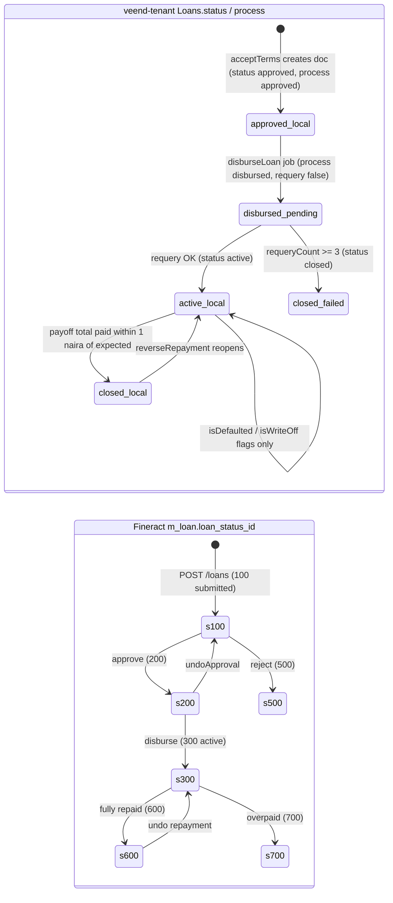
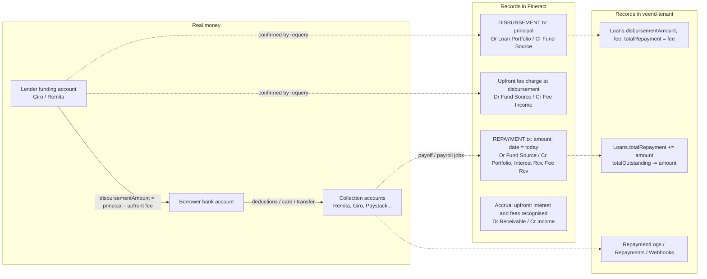

# D2.5 Financial Transaction Lifecycle (current state)

This document shows how money and the records of it move today, and where the two can diverge.

## 1. Loan state: local vs. CBA

**Divergence points [V]:**

| Local state | CBA state | When it happens |
|---|---|---|
| `approved` | `200` | Normal, between acceptTerms and disbursement |
| `active` | `300` | Normal |
| `closed` (failed disbursement) | `200` or `100` | When `undoApproval` or `rejectLoan` failed silently (errors swallowed) |
| `closed` | `300` | Local closed within 1 naira tolerance while Fineract still shows a small balance (fees or rounding) |
| `active` + `isWriteOff` | `300`, accruing | Always after a write-off: never posted |
| `active` | `600`/`700` | Fineract closed by a payroll deduction before the local job synced |

## 2. Money flow vs. record flow

[V] The GL mapping above comes from `AccrualBasedAccountingProcessorForLoan` (see [D1.1 §5](../01-assessment/fineract.md#5-accounting)). The product's accounting rule is `ACCRUAL_UPFRONT` (4), from `createLoanProduct` in `lendlot/index.js:838`.

**Unreconciled gaps:**
1. **No settlement or suspense accounting.** Every repayment hits `FUND_SOURCE` (`paymentTypeId: 1`) whatever the rail. The GL cannot reconcile against Remita, Giro or Paystack settlement statements per channel. [R] Fineract-Mod should map payment types to per-rail clearing accounts.
2. **Value date.** Money is collected on day D, but the record is dated on the posting day (D+2 or later for Remita). Arrears, accrual and penalty calculations use the wrong date.
3. **No CBA record of failed or reversed transfers** after disbursement.
4. **Commissions** (referral, recovery) and **insurance** are paid through Giro with no GL entry in the CBA.
5. **Vida repayments** are not posted at all.

## 3. Transaction identity across systems

| Event | External reference | veend-tenant record | Fineract record | Link stored? |
|---|---|---|---|---|
| Disbursement | Giro/Remita transfer ref | `Loans.disbursementLog` | `m_loan_transaction` (type 1) | No |
| Repayment (card/USSD/transfer) | Paystack/Flutterwave/CoralPay ref; `purchaseReference` | `Webhooks`, `RepaymentLogs` | `m_loan_transaction` (type 2) | No (only an `APICalls` RequestId) |
| Repayment (payroll) | Remita/IPPIS deduction id + date | `Repayments.log`, `RepaymentLogs` | type 2 | Indirectly: RequestId `${loanId}_${deductiondate}` |
| Reversal | admin action | `RepaymentLogs.paymentStatus='reversed'` | `is_reversed=true` on the original | No |

[R] Fineract-Mod requires `external_ref` (unique per tenant + channel) on every financial transaction, returned in the response, so the link is stored on both sides. See [05-modules/loan-transactions.md](../05-modules/loan-transactions.md).
