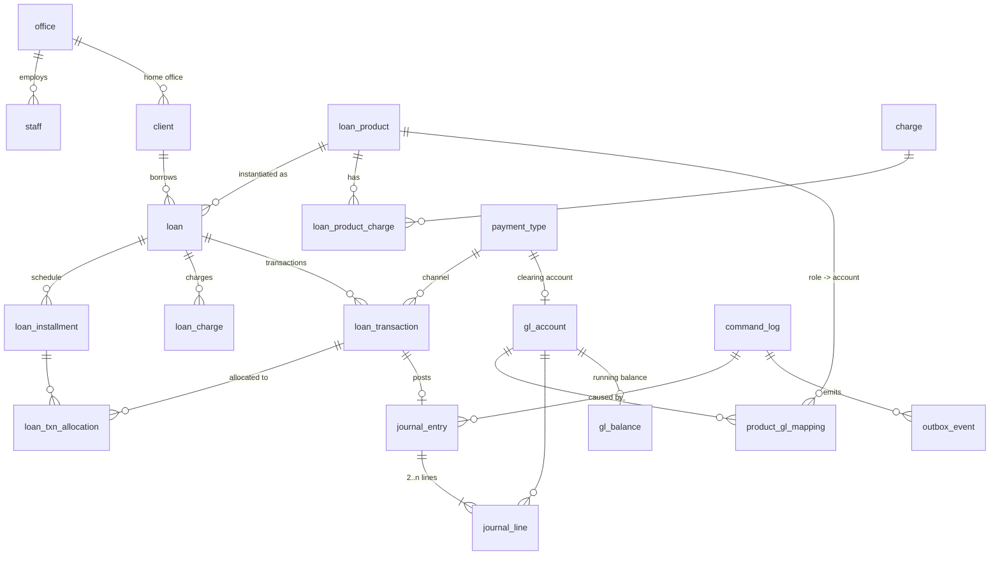

# D3.2 Data Architecture

> [R] throughout. Related decisions: [ADR-002](adr/ADR-002-postgres-decimal-orm.md) (Postgres, decimal, ORM), [ADR-003](adr/ADR-003-tenancy-model.md) (tenancy), [ADR-004](adr/ADR-004-ledger-design.md) (ledger).

## 1. Store and layout

- **Database:** PostgreSQL 16. Mongo is no longer needed for Fineract-Mod; the framework's Mongo-only features are replaced (ADR-008).
- **Schemas:**
  - `platform`: tenant registry, OAuth clients, global config, job registry and migration ledger.
  - `t_<tenantKey>`: one schema per tenant, holding all business tables. They are identical, migrated by the tenant migration runner.
  - `audit_archive` (optional): cold partitions.
- **Connection model:** one pool per process. Every tenant-scoped transaction runs `SET LOCAL search_path = t_<key>, platform` as its first statement. The tenant comes from the authenticated principal, never from the request body.
- **Migrations:** umzug with SQL files, in `db/migrations/platform/*` and `db/migrations/tenant/*`. Rules:
  - forward-only in production, with a reviewed `down` for development;
  - each tenant schema records its own version in `<schema>.schema_migrations`;
  - the runner is idempotent and resumable per tenant.

## 2. Money and numeric rules

| Rule | Detail |
|---|---|
| Storage type | `NUMERIC(19,6)` for amounts; `NUMERIC(9,6)` for rates (annual % per period) |
| In code | `decimal.js` (`Decimal`) only. Sequelize returns DECIMAL as **string**, parsed at the repository boundary. The JS `number` type is banned for money by ESLint (`no-restricted-syntax` on arithmetic over `Money`-typed values) |
| Currency precision | Each currency defines `digits_after_decimal` (NGN = 2) and `in_multiples_of`. Rounding happens **only** at defined points: installment component calculation and transaction allocation. Intermediate values keep full precision |
| Rounding mode | Per product: `HALF_EVEN` (default, as in Fineract `MoneyHelper`) or `HALF_UP`. [A] Verify the rounding mode configured in production LendLot (`c_configuration`) |
| API representation | Amounts as JSON **strings** in `/v1` (`"12500.00"`). The compat facade emits numbers, as Fineract does, so veend-tenant keeps working |
| Dates | `DATE` for business and value dates (no time zone). `TIMESTAMPTZ` for created/updated audit times. The business date per tenant comes from `business_date` |

## 3. Core tenant schema (MVP)



Key tables (abbreviated DDL; the full DDL is in each module spec):

```sql
-- money-bearing tables share these conventions
CREATE TABLE loan (
  id                 BIGSERIAL PRIMARY KEY,
  account_no         VARCHAR(20)  NOT NULL UNIQUE,
  external_id        VARCHAR(100) UNIQUE,              -- caller's id (e.g. veend Loans._id)
  legacy_fineract_id BIGINT UNIQUE,                    -- migration mapping
  client_id          BIGINT NOT NULL REFERENCES client(id),
  product_id         BIGINT NOT NULL REFERENCES loan_product(id),
  office_id          BIGINT NOT NULL REFERENCES office(id),
  currency_code      CHAR(3) NOT NULL,
  status             SMALLINT NOT NULL,                -- Fineract codes 100..700
  principal_proposed NUMERIC(19,6) NOT NULL,
  principal_approved NUMERIC(19,6),
  principal_disbursed NUMERIC(19,6) NOT NULL DEFAULT 0,
  terms              JSONB NOT NULL,                   -- frozen product terms at approval (rate, method, strategy, rounding...)
  -- derived summary, maintained in the same txn as transactions; verified by COB invariant check
  principal_outstanding NUMERIC(19,6) NOT NULL DEFAULT 0,
  interest_outstanding  NUMERIC(19,6) NOT NULL DEFAULT 0,
  fee_outstanding       NUMERIC(19,6) NOT NULL DEFAULT 0,
  penalty_outstanding   NUMERIC(19,6) NOT NULL DEFAULT 0,
  overpaid_amount       NUMERIC(19,6) NOT NULL DEFAULT 0,
  submitted_on DATE NOT NULL, approved_on DATE, disbursed_on DATE, closed_on DATE,
  last_cob_date DATE,
  version            INTEGER NOT NULL DEFAULT 0,       -- optimistic concurrency for reads-then-write APIs
  attributes         JSONB NOT NULL DEFAULT '{}',      -- replaces 'loandata' datatable
  created_at TIMESTAMPTZ NOT NULL DEFAULT now(), updated_at TIMESTAMPTZ NOT NULL DEFAULT now()
);

CREATE TABLE loan_transaction (
  id              BIGSERIAL PRIMARY KEY,
  loan_id         BIGINT NOT NULL REFERENCES loan(id),
  type            SMALLINT NOT NULL,                   -- Fineract LoanTransactionType codes
  value_date      DATE NOT NULL,                       -- economic date (was always "today" in LendLot)
  booking_date    DATE NOT NULL,                       -- business date when recorded
  amount          NUMERIC(19,6) NOT NULL CHECK (amount >= 0),
  principal_portion NUMERIC(19,6) NOT NULL DEFAULT 0,
  interest_portion  NUMERIC(19,6) NOT NULL DEFAULT 0,
  fee_portion       NUMERIC(19,6) NOT NULL DEFAULT 0,
  penalty_portion   NUMERIC(19,6) NOT NULL DEFAULT 0,
  overpayment_portion NUMERIC(19,6) NOT NULL DEFAULT 0,
  payment_type_id BIGINT REFERENCES payment_type(id),
  external_ref    VARCHAR(120),                        -- provider reference
  reversed        BOOLEAN NOT NULL DEFAULT false,
  reversed_by_txn_id BIGINT REFERENCES loan_transaction(id),
  command_id      BIGINT NOT NULL REFERENCES command_log(id),
  created_at TIMESTAMPTZ NOT NULL DEFAULT now(),
  CONSTRAINT portions_sum CHECK (principal_portion+interest_portion+fee_portion+penalty_portion+overpayment_portion = amount OR type IN (10,34)),
  CONSTRAINT uq_external_ref UNIQUE (payment_type_id, external_ref)
);

CREATE TABLE journal_entry (
  id            BIGSERIAL PRIMARY KEY,
  entry_date    DATE NOT NULL,                         -- = value_date of the source txn (subject to closure)
  office_id     BIGINT NOT NULL,
  currency_code CHAR(3) NOT NULL,
  source_type   VARCHAR(30) NOT NULL,                  -- LOAN_TXN | MANUAL | PROVISIONING | ...
  source_id     BIGINT,
  reverses_entry_id BIGINT REFERENCES journal_entry(id),
  command_id    BIGINT NOT NULL,
  created_at    TIMESTAMPTZ NOT NULL DEFAULT now()
);
CREATE TABLE journal_line (
  id            BIGSERIAL PRIMARY KEY,
  entry_id      BIGINT NOT NULL REFERENCES journal_entry(id),
  gl_account_id BIGINT NOT NULL REFERENCES gl_account(id),
  debit         NUMERIC(19,6) NOT NULL DEFAULT 0 CHECK (debit  >= 0),
  credit        NUMERIC(19,6) NOT NULL DEFAULT 0 CHECK (credit >= 0),
  loan_id       BIGINT, client_id BIGINT,              -- sub-ledger dimensions
  CHECK ((debit = 0) <> (credit = 0))
);
-- balanced-entry guarantee: DEFERRABLE constraint trigger checks SUM(debit)=SUM(credit) per entry at COMMIT
-- immutability: REVOKE UPDATE, DELETE ON journal_entry, journal_line, loan_transaction(amount/portions), command_log FROM app_role;
```

## 4. Integrity mechanisms

| Mechanism | Purpose |
|---|---|
| **Single DB transaction per command**: loan, schedule, transaction, allocations, journal, balances, audit, outbox | Atomicity |
| `SELECT … FROM loan WHERE id=$1 FOR UPDATE` at the start of every loan command | Serialises concurrent writes on one loan (replaces `m_loan_account_locks` for online writes) |
| `idempotency_key` table `(tenant, client_id, key) UNIQUE` storing the request hash and response | Exactly-once |
| Deferred constraint trigger: balanced journal | No unbalanced entries can commit |
| Immutability via grants and triggers on ledger tables | Corrections only by reversal |
| `gl_closure(office_id, closing_date)`: posting with `entry_date <= closing_date` is rejected | Period lock |
| COB invariant step: for each loan, the stored summary equals the sum of schedule minus allocations, and the GL sub-ledger balance equals the loan summary (portfolio account) | Detects drift |
| Daily trial balance check: Σ debits = Σ credits per tenant, per currency | Ledger health |
| `command_log` hash chain: `hash = sha256(prev_hash ‖ canonical(command))` | Tamper evidence |

## 5. Read models and reporting

- OLTP tables serve reads directly through indexed queries (`loan(client_id)`, `loan(status)`, `loan_installment(loan_id, due_date)`, `journal_line(gl_account_id, entry_id)`).
- `gl_balance` (per account, office and currency, running) is updated inside the posting transaction, so trial balance is O(accounts).
- Heavy reports (aging, PAR) run on a **read replica** and are materialised nightly by COB into `rpt_*` snapshot tables, which the compat reports serve.

## 6. Data retention and privacy

| Data | Retention [A: confirm with compliance; CBN expects ≥ 5 years for transaction records] | Protection |
|---|---|---|
| Ledger, transactions, command log | Indefinite (archived partitions after 7 years) | Immutable |
| Client PII (BVN, NIN, phone, DOB) | Life of relationship + 7 years | BVN and NIN encrypted with an envelope key (KMS); `bvn_hash` (HMAC) for lookup |
| Request logs | 90 days hot, 1 year cold | Headers redacted (`authorization`, `cookie`, `x-api-key`) |

## 7. Partitioning and scale

- At MVP scale [A: under 5M transactions/year], no partitioning is needed.
- `journal_line`, `loan_transaction` and `command_log` are designed for later **range partitioning by month** (`created_at`/`entry_date`). They carry no FKs into them from hot tables beyond those shown.
