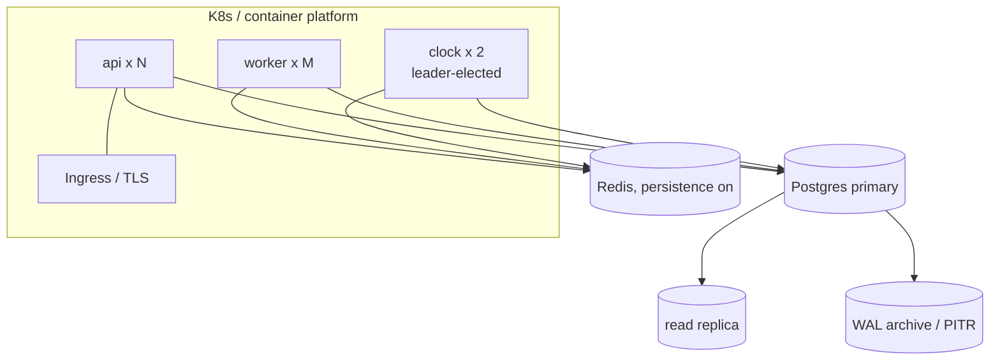

# D3.6 Logging, Monitoring, Auditability and Deployment

> [R] throughout.

## 1. Observability

| Signal | Tooling | Content |
|---|---|---|
| Logs | Structured JSON (winston, already in the framework, with a JSON formatter and redaction). Shipped to the central store (current: Loggly/New Relic, [V] veend-tenant uses both) | `ts, level, requestId, traceId, tenant, principal, route, command, loanId, durationMs, outcome`. **No bodies at info level.** PII and secrets redacted |
| Metrics | OpenTelemetry → Prometheus/Grafana (or New Relic) | RED metrics per route; commands by type and outcome; idempotent replays; lock timeouts; COB duration and partitions failed; outbox lag (oldest undispatched age); webhook failure rate; GL trial-balance delta (must be 0); DB pool saturation |
| Traces | OpenTelemetry auto-instrumentation (http, express, pg, ioredis, bull) | Propagated `traceparent` from veend-tenant |
| Health | `/health/live` (process), `/health/ready` (DB, Redis, migrations at the expected version) | The framework already exposes `/health/live` ([V] `Dockerfile`) |

### Alerts (initial)

| Alert | Condition | Severity |
|---|---|---|
| Unbalanced ledger | Trial-balance delta ≠ 0 for any tenant | P1 page |
| COB not completed | `cob_run` not SUCCEEDED by 06:00 tenant time | P1 |
| Outbox lag | Oldest undispatched > 5 min | P2 |
| Webhook DLQ | > 0 new dead letters in 15 min | P2 |
| Error rate | 5xx > 1% for 5 min | P2 |
| Audit chain broken | Daily verification failure | P1 |
| Reconciliation diff (migration period) | Any loan mismatch > ₦0.01 | P1 |

## 2. Auditability

- **`command_log`** (append-only, hash-chained) records every command:

  `id, tenant, type, permission, actor, maker, checker, status, payload_canonical, payload_hash, idempotency_key, result_summary, started_at, finished_at, prev_hash, hash`.

  It is the equivalent of [V] Fineract's `m_portfolio_command_source`, extended with the hash chain.
- **`entity_audit`** records per-entity before/after JSON diffs, linked to `command_id`.
- **Read audit:** access to PII-bearing endpoints (client detail with BVN) is logged as `pii_access(actor, client_id, fields, ts)`.
- Every journal entry and loan transaction carries `command_id`, which gives full traceability: transaction → command → actor → request.
- **Auditor API:** `GET /v1/audit?entity=loan&id=…` returns the ordered command history with diffs.

## 2a. Analytics access (Metabase)

- BI tools connect to the **read replica** with a role that can only `SELECT` from `rpt_views.*`, never from base tables or ledger tables directly.
- Each view has a catalogue entry (definition, grain, as-of semantics). This meets the recovery-team guide §9: "read approved reporting views… do not directly alter financial balances".

## 3. Deployment

| Concern | Decision |
|---|---|
| Images | One image (the framework's multi-stage `node:24-alpine`), with the process type selected by command (`api`/`worker`/`clock`). This replaces the separate clock and worker Dockerfiles |
| Environments | `dev` → `staging` (per-tenant sandboxes, anonymised data) → `prod`. Plus an ephemeral PR environment for contract tests |
| Config | 12-factor env plus a secret manager. Boot validation with zod (fail fast) |
| DB migrations | Run as a pre-deploy job: platform first, then all tenant schemas (parallel, bounded). The deploy is blocked if any tenant fails. Migrations must be backward compatible with the previous app version (expand → migrate → contract) |
| Release | Blue/green or rolling. Feature flags per tenant for new behaviour (e.g. native top-up) |
| Backups | Continuous WAL archiving (RPO 5 min). Nightly base backup. Per-tenant logical dump weekly. **Quarterly restore drill** |
| DR | Standby replica in a second zone. RTO 1 h |
| CI/CD | GitHub Actions (the framework has `.github/workflows/ci.yml`): lint, type-check, unit, property tests, golden tests, integration tests (Testcontainers Postgres + Redis), contract tests (compat recordings), SBOM, image scan, deploy |
| Capacity (initial, [A] pending volumes) | api 3 × (1 vCPU, 1 GB); worker 2 × (1 vCPU, 1 GB); Postgres 4 vCPU / 16 GB / 200 GB SSD; Redis 1 GB |

## 4. Runbooks to produce (P5/P6)

COB failure recovery · webhook DLQ redrive · reversing a mistaken repayment · posting into a closed period (reopen procedure) · tenant provisioning · key rotation · restore a single tenant · reconciliation mismatch triage.
