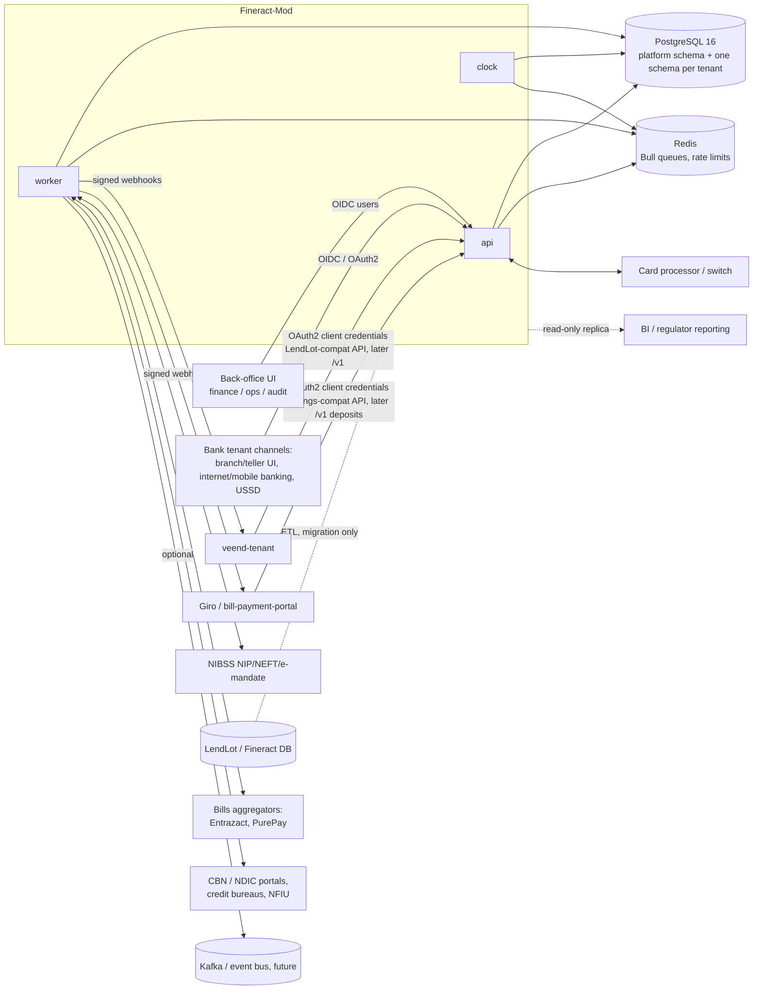
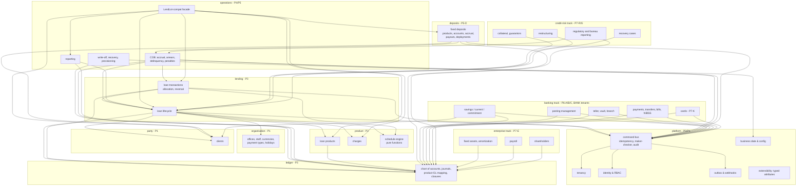

# D3.1 Fineract-Mod Target Architecture: Overview

> All content in this section is **[R] recommendation** unless tagged otherwise. Decisions are recorded in [adr/](adr/).

## 1. Architectural style

Fineract-Mod is a **modular monolith** in TypeScript, built on the `fineract-mod` Express framework and deployed as three process types:

| Process | Role | Scales by |
|---|---|---|
| `api` | HTTP: native `/v1` API plus the LendLot-compat facade | Horizontally, stateless |
| `worker` | Bull job consumers: outbox dispatch, webhooks, COB partitions, reports | Horizontally |
| `clock` | Single active scheduler (leader-elected via a Postgres advisory lock): triggers COB per tenant and periodic jobs | Active/standby |

**Why a monolith:**
- The domain is tightly coupled transactionally. A repayment touches the loan, schedule, transaction, journal, audit and outbox in **one ACID transaction**.
- The team is small, so microservices would add distributed-transaction risk with no benefit at Veend's current volume.
- Module boundaries are enforced in code (lint rules on imports) so modules can be extracted later.

## 2. Context



Money rails (Giro, Remita, IPPIS, Paystack, …) stay integrated in **veend-tenant**, and investor funding and payouts stay in **Giro**: for these LENDER and TREASURY tenants, Fineract-Mod is the system of record and does not move money. **For BANK tenants** (licensed MFBs such as Pettysave), Fineract-Mod is a full core banking system that also moves money: NIBSS, bills, teller cash and cards ([ADR-010](adr/ADR-010-full-mfb-core-banking-scope.md)). Tenant type selects the enabled modules. See [integrations-payments](../05-modules/integrations-payments.md).

## 3. Module map and boundaries



**Dependency rules:**
1. Arrows point to dependencies.
2. `schedule engine` is **pure**: no I/O, deterministic, and runnable in isolation for golden tests.
3. `ledger` depends on nothing in lending. Lending modules call the ledger's `PostingService` with a **posting request** (a role-based set of lines), and the ledger resolves the GL accounts.
4. Every write passes through `command bus`. Nothing writes to financial tables outside a command handler.
5. `COMPAT` is an adapter only, with no business rules. It translates Fineract-shaped requests into native commands.

Code layout:

```
src/
  platform/{tenancy,iam,commands,audit,idempotency,business-date,config,outbox,attributes}/
  modules/<module>/{api,commands,queries,domain,repo,events,__tests__}/
  compat/lendlot/{routes,mappers,reports}/
  jobs/{cob,outbox,reports}/
  db/migrations/{platform,tenant}/
```

## 4. Retain / customize / build

| Area | From Apache Fineract | From the fineract-mod framework | Build new |
|---|---|---|---|
| Command pipeline and maker-checker | **Customize** the design (`m_portfolio_command_source`, permission `_CHECKER`) | Express middleware | Typed command bus with idempotency |
| Loan state machine and status codes | **Retain** semantics (100/200/300/500/600/601/700) | — | TypeScript implementation |
| Schedule generation (flat, declining/EMI) | **Retain** algorithms and rounding semantics; golden-test against Fineract | — | Pure TS engine with decimal.js |
| Repayment allocation strategies | **Retain** `mifos-standard-strategy` plus live strategies [A]; others later | — | Strategy interface |
| Accounting roles and posting rules | **Retain** the role vocabulary (`AccrualAccountsForLoan`) and posting matrix | — | Balanced double-entry ledger (header + lines) |
| Charges | **Retain** time/calculation types used (1, 2, 8, 9 / 1, 2, 3) | — | |
| COB and business date | **Customize**: same steps, Bull-based runner instead of Spring Batch | Bull, clock | Partitioned, resumable COB |
| Outbox events | **Customize**: outbox table; JSON instead of Avro initially | Bull workers, `sendWebhook` | HMAC-signed webhooks |
| Multi-tenancy | **Customize**: schema per tenant instead of DB per tenant | — | Tenant resolver, migration runner |
| Datatables | **Replace** with typed JSONB attributes | — | |
| Stretchy reports | **Replace** with versioned SQL report modules | — | Compat report adapters |
| Auth | **Replace** Basic auth with OAuth2/OIDC | helmet, rate-limit | IAM module |
| CRUD generator, Mongo Trash, GET cache, MCP CRUD | — | **Disable** for financial modules | — |
| Request/response skeleton, logger, Docker, CI | — | **Retain** | — |
| Fixed deposits | **Retain** the FD status codes (100–800), savings accounting roles and rate-chart concept; **customize** with explicit tenure units, a locked rate, payout schedules, and a legacy Giro parity calculator | — | TypeScript module (P5-D) |
| Savings, current, commitment accounts; overdrafts | **Retain** semantics (`fineract-savings`: overdraft, min balance, lock-in, WHT, dormancy, status codes) | — | TypeScript module (P6-A) |
| Teller/cashier, collateral, guarantors, rescheduling, shares, credit bureau | **Retain** concepts from `fineract-branch` teller, collateral management, `Guarantor`, `LoanRescheduleRequest`, share accounts, `CreditBureau` | — | TypeScript modules (P6-B, P7-R, P7-E, P7-G) |
| NIBSS/bills, cards, payroll, fixed assets, CBN returns, recovery cases, ECL | — (not in Fineract) | — | **Build** from the recovery-team guide and regulatory sources |
| Groups, investor/participation, working capital | Future reference | — | Future (P9) |

## 5. Quality attributes and targets

| Attribute | Target |
|---|---|
| Financial correctness | 0 unbalanced journals (enforced by DB constraint). Schedule outputs equal Fineract golden fixtures to the kobo on 100% of fixture cases |
| Exactly-once | Duplicate submissions with the same idempotency key return the original result. Covered by a property-based test |
| Latency (p95) | Repayment command < 300 ms; loan booking < 800 ms; loan read < 150 ms at 50 rps per tenant [A: volumes TBD] |
| COB | All tenants' COB completes in under 30 min for 1M active loans; resumable per partition |
| Availability | 99.9% for the API; COB is allowed to lag up to 6 h without data loss |
| Auditability | Every state change is linked to a command record with actor, maker, checker, before/after and request hash. Hash chain verified daily |
| Security | OWASP ASVS L2; PII encrypted at rest (column level for BVN/NIN); no secrets in logs |
| Recoverability | RPO ≤ 5 min (WAL archiving), RTO ≤ 1 h. Per-tenant logical export |

## 6. Related documents

- [Data architecture](data-architecture.md)
- [API design](api-design.md)
- [Security and tenancy](security-tenancy.md)
- [Transaction processing, accounting, events, jobs](processing.md)
- [Operations: logging, monitoring, deployment](operations.md)
- ADRs: [001](adr/ADR-001-typescript-rebuild.md) · [002](adr/ADR-002-postgres-decimal-orm.md) · [003](adr/ADR-003-tenancy-model.md) · [004](adr/ADR-004-ledger-design.md) · [005](adr/ADR-005-command-pipeline.md) · [006](adr/ADR-006-outbox-events.md) · [007](adr/ADR-007-lendlot-compat-facade.md) · [008](adr/ADR-008-framework-hardening.md) · [009](adr/ADR-009-fineract-as-test-oracle.md) · [010](adr/ADR-010-full-mfb-core-banking-scope.md)
