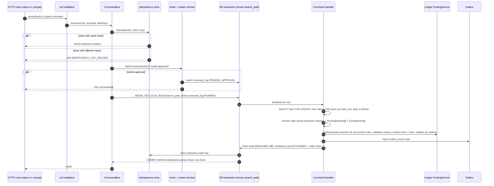
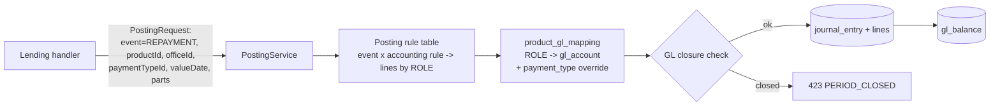
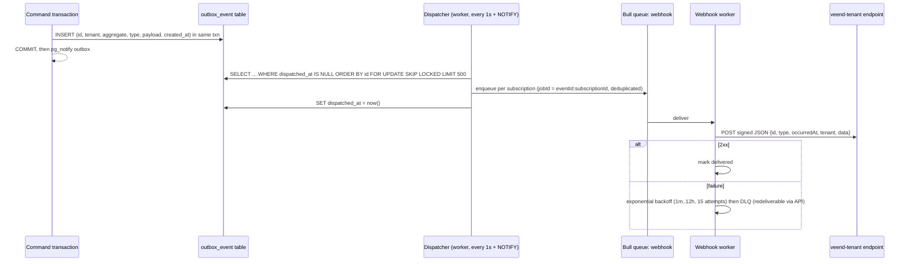

# D3.5 Transaction Processing, Accounting, Events and Jobs

> [R] throughout. Decisions: [ADR-004](adr/ADR-004-ledger-design.md), [ADR-005](adr/ADR-005-command-pipeline.md), [ADR-006](adr/ADR-006-outbox-events.md).

## 1. Command pipeline

Every state change goes through `CommandBus.execute(command, principal)`.

**Rules:**
- **R1.** One command is one DB transaction. Any error rolls back everything, including the idempotency row, so a retry is safe.
- **R2.** Domain logic is pure. It takes the loan aggregate plus inputs and returns the new state, postings and events. Handlers only orchestrate I/O.
- **R3.** Lock order: `loan` row, then `client` (if needed). The GL is never locked: `gl_balance` uses `UPDATE … SET balance = balance + $1`, and row contention is bounded by the account count. For hot accounts (fund source) we use **striped balance rows** (N stripes summed on read) if contention exceeds 5 ms p95.
- **R4.** Lock timeout `SET LOCAL lock_timeout = '3s'`. A timeout returns `409 CONCURRENT_MODIFICATION`, which is retryable.
- **R5.** Statement timeout of 10 s for online commands; COB uses its own limits.

## 2. Loan transaction processing (the "replay" model)

This follows Fineract's approach ([V] `LoanAccountDomainServiceJpa.makeRepayment` re-processes via the transaction processor). A **backdated** transaction, or a **reversal**, triggers deterministic **re-allocation** of all later transactions:

1. Load the schedule (installments, with due amounts) and all non-reversed transactions with `value_date >= D`, where D is the value date of the new or reversed transaction.
2. Reset allocations from D onwards and re-run the product's allocation strategy in `(value_date, id)` order.
3. Compute the **delta** between old and new allocations per transaction. Post **adjusting journal entries** for the delta only. Original entries are never edited.
4. Recompute derived balances, delinquency and status (e.g. CLOSED → ACTIVE).

[R] Limit: a backdate further than `max_backdate_days` (tenant config, default 31) requires maker-checker.

## 3. Accounting engine

**Posting rule table (MVP, accrual-based; mirrors [V] `AccrualBasedAccountingProcessorForLoan`):**

| Event | Debit (role) | Credit (role) |
|---|---|---|
| DISBURSEMENT | LOAN_PORTFOLIO | FUND_SOURCE, or the payment-type clearing account |
| Upfront fee (fee due at disbursement, netted) | FUND_SOURCE / clearing | INCOME_FROM_FEES (accrual upfront) or FEES_RECEIVABLE |
| ACCRUAL (interest / fee / penalty) | INTEREST / FEES / PENALTIES_RECEIVABLE | INTEREST_ON_LOANS / INCOME_FROM_FEES / INCOME_FROM_PENALTIES |
| ACCRUAL_ADJUSTMENT | reverse of ACCRUAL | |
| REPAYMENT | FUND_SOURCE / clearing | LOAN_PORTFOLIO (principal), *_RECEIVABLE (interest/fee/penalty), OVERPAYMENT (excess) |
| WAIVE_INTEREST / WAIVE_CHARGES | INTEREST_ON_LOANS / INCOME_FROM_FEES (income reversal) | *_RECEIVABLE |
| WRITEOFF | LOSSES_WRITTEN_OFF | LOAN_PORTFOLIO, *_RECEIVABLE |
| RECOVERY_REPAYMENT | FUND_SOURCE / clearing | INCOME_FROM_RECOVERY |
| REFUND (overpayment) | OVERPAYMENT | FUND_SOURCE / clearing |
| PROVISION (monthly) | PROVISION_EXPENSE | PROVISION_ALLOWANCE (contra-asset) |
| Any reversal | exact mirror of the original entry, linked by `reverses_entry_id` | |

The cash-based rule set (CASH_BASED) omits receivables: income is recognised on repayment. **ACCRUAL_UPFRONT** recognises the full schedule interest and fees as receivable/income at disbursement. That is the current veend-tenant configuration ([V] `accountingRule: 4`). **ACCRUAL_PERIODIC** recognises daily in COB.

**Payment-type clearing [R]:** each `payment_type` (REMITA, IPPIS, GIRO, PAYSTACK, FLUTTERWAVE, CORALPAY, CGATE, ONEPIPE, VIDA, MANUAL) maps to its own clearing GL account. This overrides FUND_SOURCE, as Fineract's `paymentTypeId` advanced mapping does. Finance can then reconcile each rail's settlement statement against one GL account (fixes DF-12).

## 4. Events: transactional outbox

- **Event catalogue (MVP):**
  - `client.created`, `client.updated`
  - `loan.submitted`, `loan.approved`, `loan.rejected`, `loan.approval_undone`, `loan.disbursed`, `loan.disbursement_undone`
  - `loan.repayment_posted`, `loan.transaction_reversed`
  - `loan.closed`, `loan.overpaid`, `loan.reopened`
  - `loan.overdue`, `loan.delinquency_changed`
  - `loan.written_off`, `loan.recovery_posted`
  - `loan.charge_applied`, `loan.charge_waived`
  - `journal.posted` (finance subscribers only), `cob.completed`
- **Delivery is at least once.** Consumers deduplicate on the event `id`, which is the outbox id.
- **Ordering** is per aggregate (loan id) through per-loan job grouping.
- **Schema:** JSON Schema per event type and version, published in `docs/events/` (P5). Avro over Kafka is an optional later sink: the outbox makes adding a sink trivial.

## 5. Business date and COB

| Concept | Design |
|---|---|
| Business date | `business_date(tenant, type ∈ {BUSINESS, COB}, date)`. BUSINESS defaults to "today in the tenant timezone" and is advanced by the clock at local midnight. COB date = BUSINESS − 1 |
| COB trigger | The clock enqueues `cob.run(tenant, cobDate)` after the business date advances |
| Partitioning | Active loans are split into partitions of 500 loan ids → Bull jobs `cob.partition(tenant, cobDate, [ids])` with concurrency N per tenant |
| Per-loan steps (in order; mirrors [V] Fineract `cob/loan` steps) | 1. **Lock** (row-level `FOR UPDATE SKIP LOCKED`; online commands touching a locked loan return 503 `COB_IN_PROGRESS`) · 2. **CheckDueInstallments** → emit `loan.installment_due` · 3. **Overdue detection** and **arrears aging** (days past due by oldest unpaid installment) · 4. **Apply overdue penalties** (charges with time type OVERDUE_FEES(9)) · 5. **Periodic accrual** (ACCRUAL_PERIODIC products) · 6. **Delinquency classification** (buckets, NPA flag; interest suspension if configured) · 7. **Invariant check** (summary = schedule − allocations; sub-ledger = GL portfolio share) · 8. `last_cob_date = cobDate` |
| Deposit steps (per FD account, treasury tenant) | Funding-window expiry → daily interest accrual (Dr INTEREST_ON_SAVINGS / Cr INTEREST_PAYABLE) → payouts due → maturity. See [fixed-deposits §7](../05-modules/fixed-deposits.md#7-service-layer-responsibilities) |
| Tenant-level steps | Snapshot reports (`rpt_aging`, `rpt_portfolio_summary` for compat), trial balance check, `cob.completed` event |
| Resumability | `cob_run(tenant, date, status)` and `cob_partition(run_id, idx, status, attempts)`. Re-running a date only processes partitions not yet SUCCEEDED. Steps are idempotent per (loan, date) through a unique key on generated transactions `(loan_id, type, value_date, source='COB')` |
| Inline COB | Any online command on a loan whose `last_cob_date < cobDate` first runs the COB steps for that loan inline (Fineract's `InlineLoanCOBExecutorServiceImpl` pattern) |
| Failure | A partition fails after 3 attempts → `cob_run` = PARTIAL → alert. Affected loans keep their old `last_cob_date` and are caught up inline or on the next run |

## 6. Other scheduled jobs

| Job | Schedule | Notes |
|---|---|---|
| Outbox dispatcher | Continuous | |
| Webhook retry sweeper | Every minute | |
| Idempotency key purge | Daily | Keys older than 30 days (money refs stay unique forever via the table constraint) |
| Provisioning run | Monthly (last business day) | Maker-checker on posting |
| Audit hash-chain verification | Daily | Alert on break |
| Report snapshots | After COB | |
| Reconciliation vs LendLot (migration period) | Daily during parallel run | See D6 |
