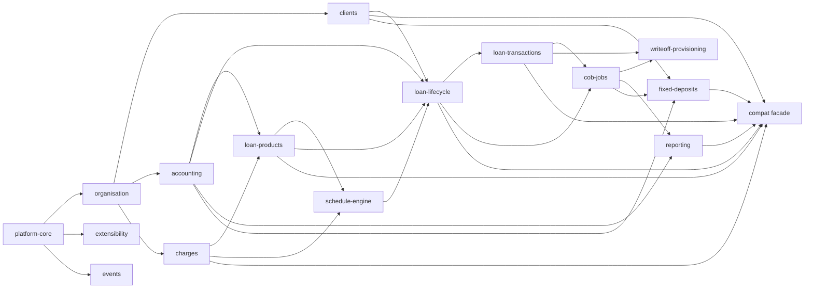

# D4 Module-by-Module Functional Documentation

Each module follows the fixed 14-section [template](_template.md). Module IDs prefix requirement and rule ids (e.g. `FR-TXN-03`, `BR-LN-08`).

| Module | Phase | Priority | Parity-critical? | Spec |
|---|---|---|---|---|
| Platform core (tenancy, IAM, command bus, maker-checker, audit, business date) | P0–P1 | P0 | Indirect | [platform-core.md](platform-core.md) |
| Organisation (offices, staff, currencies, payment types, calendar) | P1 | P1 | Payment types | [organisation.md](organisation.md) |
| Clients | P1 | P0 | **Yes** (C1–C4) | [clients.md](clients.md) |
| Extensibility (typed attributes, replacing datatables) | P1 | P1 | **Yes** (`loandata`, `userdata`) | [extensibility-datatables.md](extensibility-datatables.md) |
| Loan products | P2 | P0 | **Yes** (P1–P3, L1) | [loan-products.md](loan-products.md) |
| Charges | P2/P4 | P0 | **Yes** (P4–P6) | [charges.md](charges.md) |
| Loan schedule engine | P2 | **P0, highest risk** | **Yes** (L2) | [loan-schedule-engine.md](loan-schedule-engine.md) |
| Loan lifecycle | P3 | P0 | **Yes** (L3–L10) | [loan-lifecycle.md](loan-lifecycle.md) |
| Loan transactions | P3 | P0 | **Yes** (T1–T2) | [loan-transactions.md](loan-transactions.md) |
| Accounting | P3 | P0 | Implicit | [accounting.md](accounting.md) |
| COB and jobs | P4 | P0 | No (new) | [cob-jobs.md](cob-jobs.md) |
| Write-off, recovery, provisioning | P4 | P0 | No (fixes DF-04) | [writeoff-provisioning.md](writeoff-provisioning.md) |
| Reporting | P5 | P0 (compat) / P1 | **Yes** (R1–R3) | [reporting.md](reporting.md) |
| Events and notifications | P5 (outbox in P0) | P1 | No | [events-notifications.md](events-notifications.md) |
| Integrations boundary and LendLot-compat facade | P5 | P0 | **Yes** (all) | [integrations-payments.md](integrations-payments.md) |
| **Fixed deposits** (Giro investor term deposits) | P5-D | P0 | **Yes** (Giro G-S1..G-S6, G-C1/G-C2) | [fixed-deposits.md](fixed-deposits.md) |
| *Future:* savings / Giro wallet | P7+ | P3 (decision pending) | — | [future/savings.md](future/savings.md) |
| *Future:* recurring deposits, FD rollover and compounding | P7+ | P3 | — | [future/deposits.md](future/deposits.md) |
| *Future:* groups / GLIM | P7+ | P3 | — | [future/groups.md](future/groups.md) |
| *Future:* rescheduling / restructuring | P7 | P2 | — | [future/rescheduling.md](future/rescheduling.md) |
| *Future:* participation / inter-tenant funding | Design P3, build P7 | P1 | Interim as-is | [future/investor.md](future/investor.md) |

## Cross-module dependency graph

