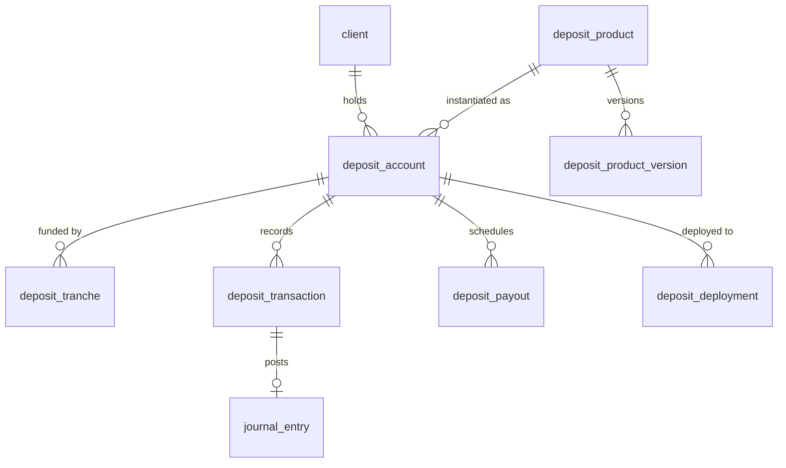

# Module: Fixed Deposits (investor term deposits)

> Phase: **P5-D** (MVP; parallel to P5) · Priority: P0 · Status: Spec draft
> Fineract reference: `fineract-savings` (`FixedDepositProduct`, `DepositProductTermAndPreClosure`, `DepositAccountInterestRateChart(+Slabs)`, `SavingsAccountStatusType` incl. `MATURED(800)`, `PRE_MATURE_CLOSURE(700)` [V]), `AccountingConstants.AccrualAccountsForSavings` (SAVINGS_REFERENCE, SAVINGS_CONTROL, INTEREST_ON_SAVINGS, INCOME_FROM_PENALTIES, TRANSFERS_SUSPENSE, INTEREST_PAYABLE …; [V] `:311-326`)
> Current owner: `bill-payment-portal` (Giro). Touchpoints: `createSubscriptionLoan`, `createFixedSavings`, `processLoanForOnlending`, `processDraftOnlendingFunds`, `checkLoanAccount`, `postInterest`, `misc.aggregatePrimeOnlendData`, the `Primelogs` model ([V] [D1.4](../01-assessment/bill-payment-portal.md), [D2.7](../02-current-state/fixed-deposits-current-state.md))

## 1. Overview & business purpose

This module is the system of record for investor term deposits (Giro "loan subscriptions"). It covers:
- principal deposited, possibly in several tranches within a funding window
- a locked rate and tenure
- interest accrual with payouts at maturity, quarterly or monthly
- maturity, premature closure and expiry or refund

Each of these is booked in a balanced ledger as a **deposit liability plus interest expense**. The module also records how deposits are **deployed** to fund on-lending loans (the investor's money becomes a lender-tenant loan asset).

Fineract-Mod does not move money. Giro keeps collecting funds and paying investors. Fineract-Mod computes what is owed and when, and records each movement Giro reports. This is the same boundary as for loans (see [integrations-payments](integrations-payments.md)).

It fixes FD-01 to FD-08 (see [D1.4 §5](../01-assessment/bill-payment-portal.md#5-weaknesses-and-defects-verified)).

## 2. Functional requirements

| ID | Requirement |
|---|---|
| FR-FD-01 | **Products**: name, currency, tenure (`value` + explicit `unit ∈ {DAYS, MONTHS}`, which fixes FD-03), min/max deposit, **target amount** per account (the "loanAmount"), funding window (days, default 3), interest rate (fixed, or a chart by amount and tenure slab), day count (ACTUAL/365 default, 360, ACTUAL/ACTUAL), interest method SIMPLE (compounding later), accrual start rule (`FUNDING_DATE` or `DEPLOYMENT_DATE`), payout options (MATURITY, QUARTERLY, MONTHLY) with per-tenure restrictions (e.g. QUARTERLY only if tenure > 3 months), premature closure (allowed?, penalty rate or interest forfeiture), active window, accounting mappings |
| FR-FD-02 | **Open account**: client, product, target amount, tenure (must match the product), payout frequency, external id (Giro `Accounts._id`), partner webhook reference (stored as an attribute). Status SUBMITTED(100) → APPROVED(200) automatically (configurable maker-checker) |
| FR-FD-03 | **Record deposits** (tranches) during the funding window: amount, value date, payment type (GIRO/bank), external ref. Idempotent and unique per (paymentType, externalRef) |
| FR-FD-04 | **Activation** (ACTIVE 300) when Σ deposits ≥ target (or ≥ min, if partial activation is enabled) within the window. On activation: **freeze the rate** from the chart (fixes FD-06), fix the maturity date as `activationDate + tenure` with calendar-correct month arithmetic (fixes FD-05), and generate the **payout schedule** |
| FR-FD-05 | **Expiry**: if not activated when the window closes, the account becomes WITHDRAWN(400, expired) with a `refundDue` amount. Giro refunds and reports `refund` with a ref |
| FR-FD-06 | **Daily accrual** in COB for each ACTIVE account. Interest per tranche from its accrual start date at full precision; rounding only at posting (fixes FD-02) |
| FR-FD-07 | **Payout schedule**: each payout row has `dueDate`, an amount computed at due date, and a status (DUE → PAID). Quarterly means exact **calendar-quarter-from-activation dates** (activation + 3, 6, 9 months) or 90-day steps, configured per product. A payout becomes DUE at COB on or after its due date, so a missed day is caught up (fixes FD-04) |
| FR-FD-08 | **Payout settlement**: Giro pays and calls `POST …/payouts/{n}/settlement {externalRef, valueDate}`. Fineract-Mod posts the entry and marks the payout PAID |
| FR-FD-09 | **Maturity** (MATURED 800) at COB on the maturity date: accrue to maturity, create the final payout (principal + unpaid interest), emit `deposit.matured`. Settlement then leads to CLOSED(600) |
| FR-FD-10 | **Premature closure** (PRE_MATURE_CLOSURE 700) on request, if the product allows: recompute interest at the penalty rate or forfeit it, reverse excess accrual, and create the final payout |
| FR-FD-11 | **Deployment tracking**: record that some or all of the deposit funded an on-lending loan (`deployment{amount, valueDate, targetTenant, targetLoanId, externalRef}`). The accrual start can key off this date (current G2 behaviour). Cross-tenant linkage goes through the platform inter-tenant service ([future/investor](future/investor.md)) |
| FR-FD-12 | **Statements and summary**: deposits, accrued-to-date, paid, payable, expected at maturity, schedule, transactions. This replaces the on-the-fly `aggregatePrimeOnlendData` |
| FR-FD-13 | **Holds**: place or release a hold on an FD (e.g. collateral). Optional, P2 |
| FR-FD-14 | **Compat**: Giro's savings endpoints G-S1..G-S6, G-C1, G-C2 ([D2.7 §4](../02-current-state/fixed-deposits-current-state.md#4-giro-cba-endpoint-inventory-compatibility-contract)) with Fineract shapes, so Giro can switch base URL. The FD summary in the compat `GET /savingsaccounts/{id}` reports the **real** balances (deposits, interest posted) |
| FR-FD-15 | **Legacy parity mode** (migration only): for deposits migrated in flight, the product version can use `LEGACY_GIRO_DAILY_ROUNDED` interest (`round2(rate × cost / 365 / 100) × days`, 90-day quarters), so that investors receive exactly what Giro displays today until maturity |

## 3. Features & sub-features

| Feature | Sub-feature | MVP? | Notes |
|---|---|---|---|
| Products | Tenure units, rate (fixed or chart), limits, funding window, payout options, premature rules | Yes | Seeded from the Giro tenant's FD savings products (10, 12, 5, 6, 13, 11) [A: export] |
| Accounts | Open, fund (multi-tranche), activate, expire/refund | Yes | |
| Interest | Daily accrual (COB), simple interest, day count, legacy parity mode | Yes | |
| Payouts | Schedule, due detection, settlement, catch-up | Yes | |
| Maturity / premature closure | | Yes / Yes (if the product allows) | [A] Product decision on premature closure (no code path exists today) |
| Deployment to on-lending | Record + link | Yes (record), P7 (full participation accounting) | |
| Referral commission on FDs | | No (stays in Giro) | `payOnlendingReferralCommission` |
| Recurring deposits | | No | [future/deposits](future/deposits.md) |
| Compounding, auto-rollover | | No (P7) | Not offered today |
| Withholding tax on interest | | [A] | Nigerian WHT on deposit interest (10%) may apply. Finance and tax to confirm |

## 4. Business rules & validations

| ID | Rule |
|---|---|
| BR-FD-01 | Deposit amount ≥ product min per account (current: ₦100,000; ₦10,000 for the 2-unit product). Σ deposits ≤ target × (1 + overfund tolerance 0). Overfunding is rejected; Giro must not deploy above target ([V] `processDraftOnlendingFunds` requires `primelog.amount == balance`) |
| BR-FD-02 | Deposits are accepted only in SUBMITTED/APPROVED during the funding window. After activation, no top-ups unless the product allows it (current: funding within 3 days, plus a "post top-up" condition `maturity > now + onlendingTopUpThreshold months` [V `jobs.js` `isEligibleForPostTopup`]; [A] confirm whether to keep this) |
| BR-FD-03 | Tenure must equal the product's tenure value and unit. Maturity = activation date + tenure, with calendar month arithmetic clamped to month end. DAYS adds days |
| BR-FD-04 | **Interest (SIMPLE):** `interest_i(d1,d2) = principal_i × rate/100 × days(d1,d2)/basis`, where `basis` is 365 (ACTUAL/365), 360, or the actual days in year. Accrue daily at full precision (`Decimal`, 34 digits). Post the accrued delta rounded HALF_EVEN to currency digits, carrying the remainder forward so Σ posted = round(Σ exact) |
| BR-FD-05 | **Accrual start per tranche** = deposit value date (`FUNDING_DATE`) or deployment value date (`DEPLOYMENT_DATE`, current behaviour [V]). Accrual end = maturity date (exclusive) |
| BR-FD-06 | **The rate is locked at activation** and never re-read (fixes FD-06). A product rate change affects new activations only |
| BR-FD-07 | **Payout amount** at due date = accrued interest to due date − interest already paid. At maturity: principal + remaining interest |
| BR-FD-08 | **Payouts are due on or after their date** (COB catch-up). Payout rows are unique on `(account, sequence)` |
| BR-FD-09 | **Premature closure:** interest is recomputed at `prematureRate` (or 0) over the elapsed term. Any excess already paid is deducted from the principal returned. A penalty may apply. The rate must not exceed the contract rate |
| BR-FD-10 | **Expiry:** at the end of the funding window, if Σ deposits < activation threshold, status becomes 400 and the full refund is due. No interest unless the product says otherwise |
| BR-FD-11 | **Deployment** amount must be ≤ Σ deposits not yet deployed. A deployment does **not** reduce the investor's liability. It moves treasury assets (see §11) |
| BR-FD-12 | Every money movement carries `(paymentType, externalRef)` and is unique, exactly as for loan transactions (BR-TXN-01) |

## 5. Data model

```sql
CREATE TABLE deposit_product (id BIGSERIAL PRIMARY KEY, name TEXT UNIQUE NOT NULL, short_name VARCHAR(4) UNIQUE NOT NULL,
  legacy_fineract_id BIGINT UNIQUE, status TEXT NOT NULL DEFAULT 'ACTIVE', current_version INT NOT NULL);
CREATE TABLE deposit_product_version (product_id BIGINT REFERENCES deposit_product(id), version INT, terms JSONB NOT NULL,
  created_at TIMESTAMPTZ DEFAULT now(), PRIMARY KEY (product_id, version));
  -- terms: {currency, tenure:{value,unit}, minDeposit, maxDeposit, fundingWindowDays, rate:{type:'FIXED'|'CHART', value?, chart?:[{minAmount,maxAmount,tenureFrom,tenureTo,rate}]},
  --         dayCount, interestMethod:'SIMPLE'|'LEGACY_GIRO_DAILY_ROUNDED', accrualStart:'FUNDING_DATE'|'DEPLOYMENT_DATE',
  --         payoutOptions:[{frequency:'MATURITY'|'QUARTERLY'|'MONTHLY', minTenureMonths}], quarterMode:'CALENDAR_MONTHS'|'DAYS_90',
  --         premature:{allowed, rate?, penaltyPct?}, accountingRule:'ACCRUAL'|'CASH'}
CREATE TABLE deposit_account (id BIGSERIAL PRIMARY KEY, account_no VARCHAR(20) UNIQUE NOT NULL, external_id VARCHAR(100) UNIQUE,
  legacy_fineract_id BIGINT UNIQUE, client_id BIGINT NOT NULL REFERENCES client(id), product_id BIGINT NOT NULL, product_version INT NOT NULL,
  status SMALLINT NOT NULL,                     -- 100,200,300,400,600,700,800 (Fineract SavingsAccountStatusType codes)
  target_amount NUMERIC(19,6) NOT NULL, payout_frequency TEXT NOT NULL,
  locked_rate NUMERIC(9,6), activated_on DATE, maturity_date DATE, funding_deadline DATE NOT NULL, closed_on DATE,
  principal_balance NUMERIC(19,6) NOT NULL DEFAULT 0, interest_accrued NUMERIC(19,6) NOT NULL DEFAULT 0,
  interest_accrued_exact NUMERIC(30,12) NOT NULL DEFAULT 0, interest_paid NUMERIC(19,6) NOT NULL DEFAULT 0,
  undeployed_amount NUMERIC(19,6) NOT NULL DEFAULT 0, last_accrual_date DATE, last_cob_date DATE,
  attributes JSONB NOT NULL DEFAULT '{}', version INT NOT NULL DEFAULT 0);
CREATE TABLE deposit_tranche (id BIGSERIAL PRIMARY KEY, account_id BIGINT NOT NULL REFERENCES deposit_account(id),
  amount NUMERIC(19,6) NOT NULL, deposit_txn_id BIGINT NOT NULL, accrual_start DATE, deployment_id BIGINT);
CREATE TABLE deposit_transaction (id BIGSERIAL PRIMARY KEY, account_id BIGINT NOT NULL REFERENCES deposit_account(id),
  type TEXT NOT NULL CHECK (type IN ('DEPOSIT','INTEREST_ACCRUAL','INTEREST_PAYOUT','PRINCIPAL_PAYOUT','REFUND','PENALTY','ACCRUAL_REVERSAL')),
  value_date DATE NOT NULL, booking_date DATE NOT NULL, amount NUMERIC(19,6) NOT NULL CHECK (amount >= 0),
  payment_type_id BIGINT REFERENCES payment_type(id), external_ref VARCHAR(120), reversed BOOLEAN DEFAULT false,
  command_id BIGINT NOT NULL, UNIQUE (payment_type_id, external_ref));
CREATE UNIQUE INDEX uq_fd_accrual_day ON deposit_transaction(account_id, value_date) WHERE type = 'INTEREST_ACCRUAL';
CREATE TABLE deposit_payout (account_id BIGINT REFERENCES deposit_account(id), seq SMALLINT, due_date DATE NOT NULL,
  kind TEXT NOT NULL CHECK (kind IN ('INTEREST','MATURITY','PREMATURE','REFUND')), amount NUMERIC(19,6),
  status TEXT NOT NULL CHECK (status IN ('SCHEDULED','DUE','PAID','CANCELLED')), settled_txn_id BIGINT, PRIMARY KEY (account_id, seq));
CREATE TABLE deposit_deployment (id BIGSERIAL PRIMARY KEY, account_id BIGINT REFERENCES deposit_account(id), amount NUMERIC(19,6) NOT NULL,
  value_date DATE NOT NULL, target_tenant TEXT, target_loan_ref TEXT, inter_tenant_transfer_id BIGINT, external_ref VARCHAR(120) UNIQUE,
  status TEXT NOT NULL CHECK (status IN ('PENDING','COMPLETED','FAILED','COMPENSATED')));
```



## 6. API endpoints

**Native:**
- `GET/POST /v1/deposit-products`, `GET/PATCH /v1/deposit-products/{id}`
- `POST /v1/deposit-accounts` (Idempotency-Key; `{clientId, productId, targetAmount, payoutFrequency, externalId, attributes}`)
- `GET /v1/deposit-accounts/{id}?include=tranches,schedule,transactions,deployments`, `GET /v1/deposit-accounts/external/{externalId}`
- `POST /v1/deposit-accounts/{id}/deposits` (`{amount, valueDate, paymentType, externalRef}`)
- `POST /v1/deposit-accounts/{id}/deployments` (`{amount, valueDate, targetTenant, targetLoanRef, externalRef}`)
- `POST /v1/deposit-accounts/{id}/payouts/{seq}/settlement` (`{externalRef, valueDate, paymentType}`)
- `POST /v1/deposit-accounts/{id}/premature-closure` (maker-checker), `POST /v1/deposit-accounts/{id}/refund-settlement`
- `GET /v1/deposit-accounts/{id}/summary` (deposits, accruedToDate, paid, payable, expectedAtMaturity, maturityDate, nextPayout)
- `GET /v1/deposit-payouts?status=DUE&dueBefore=`: Giro's payout worklist, replacing `dailyCheckLoanAccounts`

**Compat** (Giro tenant; shapes per Fineract savings API):
- `POST /savingsaccounts` → `{savingsId, resourceId}`; `?command=approve` and `?command=activate` are no-ops returning success. Activation is driven by funding (FR-FD-04), and compat callers do not fund through the CBA in G2.
- `GET /savingsproducts`: FD products in Fineract savings-product shape (`id, name, nominalAnnualInterestRate, lockinPeriodFrequency, lockinPeriodFrequencyType`).
- `GET /savingsaccounts/{id}?associations=…`: `summary.{accountBalance, availableBalance, totalInterestPosted}`, `nominalAnnualInterestRate`, `status.{active, matured, closed}`, `transactions[]`.
- `GET /savingsaccounts/{id}/transactions/{txId}`.
- `POST /savingsaccounts/{id}?command=postInterest`: a no-op that returns the current state (interest is accrued by COB).
- `GET /clients/{id}/accounts` → `savingsAccounts[]` with FD and wallet accounts.

## 7. Service-layer responsibilities

- Commands: `CreateDepositProduct`, `OpenDepositAccount`, `RecordDeposit`, `ActivateDeposit` (auto), `ExpireDeposit` (COB), `RecordDeployment`, `SettlePayout`, `PrematureClose`, `SettleRefund`.
- Domain (pure): `DepositInterestCalculator` (SIMPLE + LEGACY_GIRO_DAILY_ROUNDED), `PayoutScheduleGenerator`, `DepositStateMachine`.
- COB steps: `DepositAccrualStep`, `PayoutDueStep`, `MaturityStep`, `FundingWindowExpiryStep`.

## 8. Dependencies

platform-core, clients, organisation (payment types GIRO, BANK_TRANSFER), accounting, COB, events. The inter-tenant service is needed for deployments ([future/investor](future/investor.md); a minimal record is in MVP).

## 9. Integration requirements

- **Giro (bill-payment-portal)** is the consumer. It keeps collecting funds and paying investors, referral commissions, investor notifications and partner `webhookURL` callbacks. Giro changes are listed in [D6 §12](../07-migration-strategy.md#12-giro-fixed-deposit-migration).
- **veend-tenant** `/onlending/disburse` keeps booking the Eden loan on the lender tenant. Its loan id is recorded as `deposit_deployment.target_loan_ref`.
- **Events:** `deposit.opened`, `deposit.funded` (each tranche), `deposit.activated`, `deposit.expired`, `deposit.payout_due`, `deposit.payout_settled`, `deposit.matured`, `deposit.closed`, `deposit.prematurely_closed`, `deposit.deployed`.

## 10. Authorization & permissions

`CREATE/UPDATE/READ_DEPOSITPRODUCT`, `CREATE_DEPOSITACCOUNT`, `DEPOSIT_DEPOSITACCOUNT`, `DEPLOY_DEPOSITACCOUNT`, `SETTLEPAYOUT_DEPOSITACCOUNT`, `PREMATURECLOSE_DEPOSITACCOUNT` (+ `_CHECKER`), `READ_DEPOSITACCOUNT`. Giro uses a `SERVICE_TREASURY` role.

## 11. Transactional & accounting implications

Roles reuse Fineract's savings vocabulary ([V] `AccrualAccountsForSavings`), plus two treasury roles:

| Event | Debit | Credit |
|---|---|---|
| Deposit (tranche) | Clearing for the payment type (GIRO), i.e. SAVINGS_REFERENCE | SAVINGS_CONTROL (deposit liability) |
| Daily interest accrual | INTEREST_ON_SAVINGS (expense) | INTEREST_PAYABLE (liability) |
| Interest payout settled | INTEREST_PAYABLE | Clearing (GIRO) |
| Maturity principal payout | SAVINGS_CONTROL | Clearing (GIRO) |
| Premature closure: excess accrual reversal | INTEREST_PAYABLE | INTEREST_ON_SAVINGS |
| Premature penalty (if any) | SAVINGS_CONTROL | INCOME_FROM_PENALTIES |
| Expiry refund | SAVINGS_CONTROL | Clearing (GIRO) |
| **Deployment to on-lending** (treasury) | ONLENDING_FUNDING_RECEIVABLE (asset; new role) | Clearing (GIRO pool) |
| Deployment repaid by the lender tenant | Clearing | ONLENDING_FUNDING_RECEIVABLE (principal), ONLENDING_INTEREST_INCOME (interest margin; new role) |

All of a command's lines are posted in one transaction (platform rule). The deposit sub-ledger (`deposit_account.principal_balance`, `interest_accrued − interest_paid`) must equal the SAVINGS_CONTROL and INTEREST_PAYABLE GL balances per account (COB invariant, as for loans).

[A] Finance needs to decide whether the treasury entity (Giro / Veend) or the lender tenant is the counterparty on the deposit, i.e. whose balance sheet the liability sits on. That decides which tenant books the entries above.

## 12. Error handling & edge cases

| Case | Behaviour |
|---|---|
| Duplicate funding webhook from Giro | Unique `(paymentType, externalRef)` returns the original |
| Funding arrives after the window | 422 `FUNDING_WINDOW_CLOSED`. Giro refunds (today's behaviour: the account expires) |
| Deployment fails after Giro moved funds (FD-09) | The deployment stays `PENDING`. Ops completes it with the target loan ref or marks it `COMPENSATED` with a return transfer ref. Neither changes the investor liability |
| Payout settlement amount differs from the scheduled amount | 422, unless `override=true` under maker-checker |
| COB missed for days | Accrual catches up per day, and overdue payouts become DUE (FD-04 fixed) |
| Product rate changed mid-term | No effect on active accounts (locked) |
| Tenure in days crossing a leap day | ACTUAL/365 counts the extra day; golden-tested |
| Investor client closed while a deposit is active | Rejected (BR-CLI-04 analogue) |

## 13. Testing requirements

- **Unit and property tests:** Σ posted accrual = round(Σ exact); payout schedule dates; state machine.
- **Golden (current behaviour):** for 500 real G2 accounts (anonymised), the `LEGACY_GIRO_DAILY_ROUNDED` calculator reproduces `aggregatePrimeOnlendData` outputs **exactly** (deposits, earnings, interest due, maturity amount). This is the gate for migrating in-flight deposits.
- **Golden (Fineract):** G1 accounts. Replaying Fineract FD/savings postings reproduces `summary.totalInterestPosted` for products 10/12/5/6/13/11 [A: confirm their interest settings].
- **Accounting:** the trial balance stays at zero; the sub-ledger equals GL per account.
- **Compat contract:** recorded Giro `APICalls` for G-S1..G-S6 and G-C1/G-C2.

## 14. Implementation status & outstanding gaps

- Not implemented. The current product runs in Giro with no ledger (FD-01).
- **[A] Open decisions:**
  1. The balance-sheet owner of the deposit (Giro/Veend treasury vs lender tenant).
  2. Whether the accrual start is the funding date or the deployment date. Today it is the deployment date, which means investors earn nothing between funding and deployment.
  3. Premature-closure policy (not offered today).
  4. Withholding tax on interest.
  5. Tenure `'2'`: is it 2 days or 2 months (FD-03)?
  6. Whether the Giro **wallet** ledger also moves into Fineract-Mod (out of scope for this module; see [future/savings](future/savings.md)).
