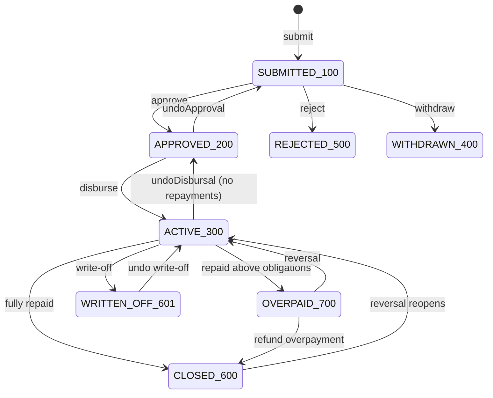

# Module: Loan Lifecycle (origination → closure)

> Phase: P3 · Priority: P0 · Status: Spec draft
> Fineract reference: `Loan`, `LoanStatus` ([V] `fineract-core/.../LoanStatus.java:28-39`), `LoansApiResource:688-698, 1357-1383`, `LoanWritePlatformServiceJpaRepositoryImpl.disburseLoan`, `LoanApplicationWritePlatformService`, `m_loan_topup`
> veend-tenant touchpoints: `createLoan` (15 call sites), `approveLoan` (25), `disburseLoan` (24), `undoApproval` (4), `rejectLoan` (4), `getLoan` (30), `getLoanSchedule` (12) ([V] D2.2)

## 1. Overview & business purpose

This module manages the loan aggregate from application to closure: submission, approval (with undo), rejection or withdrawal, disbursement (with undo), top-up, and closure. It owns `loan`, `loan_installment` (persisting the schedule-engine output) and `loan_charge` instances. Money-moving transactions after disbursement belong to [loan-transactions](loan-transactions.md).

## 2. Functional requirements

| ID | Requirement |
|---|---|
| FR-LN-01 | **Submit** (`100`): client (ACTIVE), product (ACTIVE), principal, numberOfRepayments, optional rate override within the product range, expectedDisbursementDate, submittedOn (≤ business date), charges (default from the product), attributes (`loanReason`, `channel`), externalId |
| FR-LN-02 | **Approve** (`200`): approvedOn (≥ submittedOn, ≤ business date), optional `approvedLoanAmount` ≤ proposed. Freeze `terms` and the schedule |
| FR-LN-03 | **Undo approval** (`200 → 100`), only if not disbursed |
| FR-LN-04 | **Reject** (`100 → 500`) and **withdraw** (`100 → 400`) |
| FR-LN-05 | **Disburse** (`200 → 300`): `actualDisbursementDate` (≥ approvedOn, ≤ business date, within backdate limit), optional `transactionAmount` ≤ approved, `paymentType`, `externalRef` (the rail's transfer reference). Regenerate the schedule from the actual date. Post the DISBURSEMENT transaction and collect disbursement-time fees (`REPAYMENT_AT_DISBURSEMENT`). Under ACCRUAL_UPFRONT, recognise the interest and fee receivables |
| FR-LN-06 | **Undo disbursal** (`300 → 200`), only if there are no non-reversed repayments. Reverses all postings |
| FR-LN-07 | **Book** (composite, single command): submit + approve [+ disburse], used by veend-tenant's auto-approval flows. This replaces the copy-pasted sequence in at least 11 places ([V] DS-11) and is atomic |
| FR-LN-08 | **Top-up** (feature flag, product `canUseForTopup`): a new loan with `loanIdToClose`. At disbursement, an internal repayment closes the old loan using the payoff amount on the disbursement date. Net cash = principal − fees − payoff. Both happen in one command (fixes DF-07) |
| FR-LN-09 | **Status derivation** after every transaction: ACTIVE(300) / CLOSED_OBLIGATIONS_MET(600) / OVERPAID(700) / CLOSED_WRITTEN_OFF(601) |
| FR-LN-10 | **Read model** `GET /loans/{id}`: summary, status flags, timeline, schedule, transactions and charges. Compat shape per D2.2 §4 |
| FR-LN-11 | **Payoff quote** for a date: outstanding principal + interest due to date (per product method) + fees + penalties |

## 3. Features

| Feature | Sub-feature | MVP? |
|---|---|---|
| Origination | Submit, modify (pre-approval), approve/undo, reject, withdraw | Yes |
| Composite booking | `POST /v1/loans/book`; compat create → approve → (disburse) still supported | Yes |
| Disbursement | Single tranche, undo, net-of-fees | Yes |
| Top-up | Atomic close of previous loan | Yes (flag; [A] business sign-off) |
| Multi-tranche | | No |
| Loan officer assignment | | No (recovery agents stay in veend-tenant) |
| Guarantors, collateral | | No |
| Loan sale / participation | | P7 ([future/investor](future/investor.md)) |

## 4. Business rules

| ID | Rule |
|---|---|
| BR-LN-01 | State machine (see the diagram). Any other transition is 409 `INVALID_STATE` |
| BR-LN-02 | Principal and repayments are within the product min/max. The rate is within min/max unless the product allows override [A] |
| BR-LN-03 | The client must be ACTIVE on submit and disburse |
| BR-LN-04 | Dates: `submittedOn ≤ approvedOn ≤ actualDisbursementDate ≤ businessDate`. A backdate beyond `max_backdate_days` needs maker-checker |
| BR-LN-05 | The disbursement amount must not exceed the approved principal |
| BR-LN-06 | On disbursement, the schedule is **regenerated** from `actualDisbursementDate`, matching Fineract. The compat GET reflects it |
| BR-LN-07 | `externalId` is unique per tenant. veend-tenant sends the Mongo `Loans._id` or `VidaBnplLoans._id` (M2) |
| BR-LN-08 | Closure: status → 600 when Σ outstanding (principal + interest + fees + penalties) = 0 and the overpaid amount is 0. Status → 700 when the overpaid amount > 0 |
| BR-LN-09 | Undo disbursal is not allowed after any repayment (reverse the repayments first) or in a closed GL period |
| BR-LN-10 | Account numbers are zero-padded 9 digits of `id` (Fineract default). veend-tenant strips leading zeros from the Aging report ([V] `jobs.js:7938`) |



## 5. Data model

`loan` (see [data-architecture §3](../04-target-architecture/data-architecture.md#3-core-tenant-schema-mvp)), `loan_installment` (see [schedule engine §5](loan-schedule-engine.md#5-data-model)), `loan_charge` (see [charges](charges.md)), plus:

```sql
CREATE TABLE loan_topup (loan_id BIGINT PRIMARY KEY REFERENCES loan(id), closed_loan_id BIGINT NOT NULL REFERENCES loan(id),
  payoff_amount NUMERIC(19,6) NOT NULL, closing_txn_id BIGINT REFERENCES loan_transaction(id));
CREATE TABLE loan_status_history (id BIGSERIAL PRIMARY KEY, loan_id BIGINT REFERENCES loan(id), from_status SMALLINT, to_status SMALLINT,
  on_date DATE NOT NULL, command_id BIGINT NOT NULL, note TEXT);
CREATE INDEX ix_loan_client ON loan(client_id); CREATE INDEX ix_loan_status ON loan(status);
```

## 6. API endpoints

**Native:**
- `POST /v1/loans`
- `POST /v1/loans/book` (`{clientId, productId, principal, numberOfRepayments, interestRatePerPeriod?, submittedOn?, approve:true, disburse?:{date, paymentType, externalRef}, attributes, externalId}`)
- `GET /v1/loans/{id}?include=schedule,transactions,charges`, `GET /v1/loans/external/{externalId}`
- `GET /v1/clients/{id}/loans`
- `POST /v1/loans/{id}/approval`, `DELETE /v1/loans/{id}/approval`, `POST /v1/loans/{id}/rejection`, `POST /v1/loans/{id}/withdrawal`
- `POST /v1/loans/{id}/disbursements`, `DELETE /v1/loans/{id}/disbursements/last`
- `GET /v1/loans/{id}/payoff-quote?date=`

**Compat** (shapes per D2.2):
- `POST /loans` returns `{officeId, clientId, loanId, resourceId}`.
- `POST /loans/{id}?command=approve|undoApproval|reject|disburse` returns `{loanId, resourceId, changes}`.
- `POST /loans/{id}/disbursements/editDisbursements` returns 400 unless a valid single-tranche payload is sent (DF-08).
- `GET /loans/{id}?associations=all|repaymentSchedule`.

Compat `GET /loans/{id}` must provide at minimum:

```json
{ "id": 48211, "accountNo": "000048211", "clientId": 902, "loanProductId": 7,
  "principal": 100000, "approvedPrincipal": 100000, "interestRatePerPeriod": 4,
  "status": {"id":300,"code":"loanStatusType.active","value":"Active","pendingApproval":false,"waitingForDisbursal":false,
             "active":true,"closedObligationsMet":false,"closedWrittenOff":false,"closed":false,"overpaid":false},
  "timeline": {"submittedOnDate":[2026,11,2],"approvedOnDate":[2026,11,2],"actualDisbursementDate":[2026,11,2],"expectedMaturityDate":[2027,5,2]},
  "feeChargesAtDisbursementCharged": 2000,
  "summary": {"totalRepayment": 0, "totalOutstanding": 124000, "principalOutstanding": 100000, "interestOutstanding": 24000, "feeChargesOutstanding": 0, "penaltyChargesOutstanding": 0},
  "repaymentSchedule": {"totalPrincipalDisbursed":100000,"totalInterestCharged":24000,"totalFeeChargesCharged":2000,
     "totalRepaymentExpected":126000,"totalRepayment":2000,"totalOutstanding":124000,"periods":[ ... ]},
  "transactions": [{"id":990120,"type":{"id":1,"code":"loanTransactionType.disbursement"},"date":[2026,11,2],"amount":100000,"manuallyReversed":false}] }
```

## 7. Service-layer responsibilities

- Commands: `SubmitLoan`, `ModifyLoanApplication`, `ApproveLoan`, `UndoApproveLoan`, `RejectLoan`, `WithdrawLoan`, `DisburseLoan`, `UndoDisburseLoan`, `BookLoan` (composite), `TopUpDisburse`.
- Domain: `LoanAggregate` (pure state transitions), `LoanSummaryCalculator`, `LoanStatusDeriver`.
- Queries: `GetLoan`, `PayoffQuote`, `FindLoans`.

## 8. Dependencies

clients, loan-products, charges, schedule engine, accounting (PostingService), platform-core. Consumed by loan-transactions, COB, writeoff-provisioning, reporting and compat.

## 9. Integration

Events: `loan.submitted`, `loan.approved`, `loan.approval_undone`, `loan.rejected`, `loan.withdrawn`, `loan.disbursed`, `loan.disbursement_undone`, `loan.closed`, `loan.topup_closed_previous`.

## 10. Authorization

`CREATE_LOAN`, `UPDATE_LOAN`, `APPROVE_LOAN` (maker-checker option, with an amount threshold), `UNDOAPPROVAL_LOAN`, `REJECT_LOAN`, `WITHDRAW_LOAN`, `DISBURSE_LOAN`, `DISBURSALUNDO_LOAN` (maker-checker recommended), `READ_LOAN`.

## 11. Transactional & accounting implications

| Event | Postings (ACCRUAL_UPFRONT, the production rule) |
|---|---|
| Disburse principal P | Dr LOAN_PORTFOLIO P / Cr FUND_SOURCE or clearing P |
| Upfront fee F collected at disbursement | Dr FUND_SOURCE/clearing F / Cr INCOME_FROM_FEES F |
| Upfront accrual of the total schedule interest I and instalment fees Fi | Dr INTEREST_RECEIVABLE I, Dr FEES_RECEIVABLE Fi / Cr INTEREST_ON_LOANS I, Cr INCOME_FROM_FEES Fi |
| Undo disbursal | Exact reversal of all the above |
| Top-up | The disbursement entries above, plus an internal REPAYMENT on the old loan with payment type `TOPUP_INTERNAL`, whose clearing account nets to zero against the new disbursement |

[A] Confirm with finance that ACCRUAL_UPFRONT (full interest recognised at disbursement) is the intended policy. IFRS 9 generally expects effective-interest recognition over the term, i.e. periodic. This is a **policy decision** to flag, not a code decision (R-FIN-05).

All of a command's entries share one `journal_entry` per transaction, dated with `actualDisbursementDate`.

## 12. Error handling & edge cases

| Case | Behaviour |
|---|---|
| Disburse called twice (retry) | Idempotency replay. Without a key: 409 `INVALID_STATE` (already ACTIVE). The compat facade maps this to Fineract's error shape |
| Rail transfer fails after CBA disbursement | `DELETE /disbursements/last` (undo) by ops (maker-checker). Replaces today's missing path |
| Booking composite fails at disbursement | The whole command rolls back; nothing is persisted. veend-tenant receives an error and can retry with the same key |
| Rate override outside the range | 422 |
| Client closed between approve and disburse | 422 |
| Top-up where payoff > new principal − fees | 422 `TOPUP_INSUFFICIENT_PRINCIPAL` |

## 13. Testing

- State-machine exhaustive tests (every state × every command).
- Golden: book → disburse for each live product, with the GET response compared field by field with Fineract for the fields in D2.2 §4.
- Concurrency: approve and reject racing gives one winner.
- Compat contract tests for L2–L10.

## 14. Status & gaps

- Not implemented.
- [A] Accounting-policy confirmation (upfront vs periodic).
- [A] Top-up business rules: payoff definition (interest to date vs full schedule interest).
