# D5 Development Roadmap

> [R] throughout.
>
> **Planning assumptions [A]:**
> - Team: 4 backend engineers (TypeScript), 1 QA/SDET, 1 DevOps (shared), a finance/accounting SME (~40%), a product owner, and access to the LendLot production DB (read replica) and the `APICalls` logs.
> - Durations are engineering weeks for this team. Calendar dates are set at kickoff.

## 1. Phase overview

```mermaid
gantt
    title Fineract-Mod delivery (relative weeks)
    dateFormat X
    axisFormat W%s
    section Discovery
    P-D Production discovery (LendLot data, reports, products)   :pd, 0, 3
    section Build
    P0 Foundations (framework hardening, platform core)          :p0, 0, 6
    P1 Platform & party (org, clients, attributes, maker-checker) :p1, after p0, 4
    P2 Products, charges, schedule engine + golden harness       :p2, after p1, 6
    P3 Ledger, loan lifecycle, transactions                       :p3, after p2, 8
    P4 COB, write-off, provisioning                               :p4, after p3, 5
    P5 Reporting, events, compat facade, CbaClient SDK            :p5, after p4, 5
    P5-D Fixed deposits (Giro) + savings compat                    :p5d, after p4, 6
    section Migrate
    P6 ETL, reconciliation, shadow run, tenant cut-overs          :p6, after p5, 8
    P6-G Giro FD migration + cut-over                              :p6g, after p5d, 5
    section Future
    P7 Rescheduling, participation, savings/deposits...           :p7, after p6, 12
```

**Critical path:** P0 → P2 (schedule-engine parity) → P3 (ledger + transactions) → P5 (compat facade) → P6. P-D runs in parallel with P0 and **must finish before P2 starts**, because golden fixtures need production product configurations.

| Phase | Milestone (exit gate) | Weeks |
|---|---|---|
| P-D | **G-D:** production facts captured (§2) | 3 |
| P0 | **G0:** hardened framework; platform core green in CI; security baseline | 6 |
| P1 | **G1:** clients + compat C1–C4 contract-green | 4 |
| P2 | **G2:** schedule engine 100% kobo-exact on golden set | 6 |
| P3 | **G3:** end-to-end book → repay → reverse with balanced GL; golden allocation 100% | 8 |
| P4 | **G4:** 400-day COB time-travel matches Fineract; write-off/provisioning postings approved by finance | 5 |
| P5 | **G5:** compat facade passes the recorded-traffic contract suite; events delivered to veend-tenant staging; pen test passed (**G-SEC**) | 5 |
| P5-D | **G5-D:** FD engine equals Giro's current figures exactly in legacy mode, and the native mode is approved by finance; Giro savings-compat corpus green; deposit sub-ledger equals GL | 6 (parallel to P5; needs +1 engineer, or extends the plan by about 4 weeks) |
| P6 | **G6:** per-tenant cut-overs complete with zero reconciliation diffs | 8 |
| P6-G | **G6-G:** Giro FD book migrated, opening liability approved by finance, Giro switched | 5 (parallel to P6) |

## 2. Phase P-D: Production discovery (parallel to P0)

| Task | Output | Acceptance |
|---|---|---|
| D1 Capture the LendLot Fineract version, DB engine, deployed config (`c_configuration`) and the scheduler job list and history | `discovery/lendlot-runtime.md` | Version pinned for the golden harness |
| D2 Export `m_product_loan` (+ satellites), `m_charge`, `acc_gl_account`, `acc_product_mapping`, `m_payment_type`, `x_registered_table` and the datatable DDL for every tenant | CSV/JSON snapshot + summary | Every live product's strategy, rounding, days-in-year/month and charges listed |
| D3 Extract the `stretchy_report` SQL for `ActiveLoansSummary` and `Aging Detail` | SQL files + column lists | All 15 aging columns and the summary columns named |
| D4 Volume profile: tenants, clients, loans by status, transactions per day, peak rps | Sizing note | Feeds capacity planning |
| D5 Sample `APICalls` (scrubbed) per live endpoint (≥ 200 each) | Contract-test corpus | Covers every row of D2.2 §2 |
| D6 Finance policy workshop: accrual upfront vs periodic, write-off treatment, provisioning %, reversal windows, maker-checker thresholds, rounding | Signed policy sheet | All [A] policy items in the module specs closed |
| D7 Business confirmations: top-up behaviour (DF-07), Vida repayment posting (DF-09), LoanDisk decommission, restructuring practice | Decision log | |
| D8 **Giro FD discovery**: export Giro-tenant FD savings products (10, 12, 5, 6, 13, 11 and the active list), FD account counts by generation (G1 non-V3, G2 CBA-exclusive), open `Primelogs`, `interestPayouts`, expired-unrefunded accounts, pending `disbursement_failed`; scrubbed Giro `APICalls` for G-S*/G-C* | Snapshot + summary | Volumes and balances per generation known |
| D9 **FD policy workshop** (finance, treasury, product): balance-sheet owner of deposits, accrual start (funding vs deployment), tenure `'2'` meaning, premature closure, WHT on interest, quarter definition, Giro wallet in or out of scope | Signed decision sheet | All [A] items in fixed-deposits §14 closed |

## 3. Phase P0: Foundations

| Module | Feature | Sub-feature | Technical tasks | Depends on | Deliverables | Acceptance criteria | Testing | Prio |
|---|---|---|---|---|---|---|---|---|
| Framework | DB layer | Postgres + migrations | Postgres-only config; umzug runners (platform/tenant); ban `.sync()` (lint); Testcontainers in CI | — | `src/db/*`, CI job | Fresh DB migrates platform + 3 tenants in < 60 s; rerun is a no-op | Integration | P0 |
| Framework | Money | Decimal | `Money` type over decimal.js; repository (de)serialisers; ESLint rule against `number` arithmetic on money | — | `src/platform/money` | Lint fails on `amount * 1`; round-trip `NUMERIC(19,6)` exact | Unit + property | P0 |
| Framework | Transactions | Managed txn + locks | AsyncLocalStorage txn context; `withTenantTx()`; `lockLoan()`; lock and statement timeouts | DB layer | `src/platform/tx` | Nested repo calls join the txn; timeout returns 409 | Integration | P0 |
| Framework | Hardening | ADR-008 rows G7–G15 | Remove bulk PUT/DELETE from templates; disable the GET cache for `/v1`; MCP off in prod; drop the x-tag path; fix the version loader; Mongo optional | — | PR series | Each gap has a regression test | Unit | P0 |
| Platform | Tenancy | Registry, provisioning, isolation | `platform.tenant`, roles per tenant, `SET LOCAL ROLE/search_path`, provisioning command | DB layer | Tenancy module | Cross-tenant access test suite passes | Integration + security | P0 |
| Platform | IAM | OAuth2 CC, OIDC, RBAC, compat Basic | Token endpoint, JWT middleware, permission seed (Fineract codes), roles | Tenancy | IAM module | Unauthorised = 401/403 on every route (route-table test) | Unit + integration | P0 |
| Platform | Command bus | Validation, idempotency, audit | `CommandBus`, registry, zod, `idempotency_key`, `command_log` hash chain, `entity_audit` | Txn, IAM | Command module | 100 concurrent identical requests produce 1 execution | Property + concurrency | P0 |
| Platform | Outbox | Table + dispatcher skeleton | `outbox_event`, dispatcher with SKIP LOCKED, NOTIFY | Command bus | Outbox | Event survives a crash after commit | Chaos test | P0 |
| Platform | Business date | Get/advance/auto-roll | `business_date`, clock leader election | Tenancy | | Date never goes backwards | Unit | P0 |
| Ops | Observability | Logs, metrics, traces, health | JSON logs with redaction; OTel; `/health/ready` | — | Dashboards v0 | No secrets in a log-capture test | Unit | P0 |
| Ops | CI/CD | Pipeline | Lint, type-check, unit, integration, SBOM, image scan, deploy to dev | — | Pipeline | Green main; deploy to dev on merge | — | P0 |

**G0 exit:** all of the above, plus a security review of auth and tenancy, plus `docs/` updated.

## 4. Phase P1: Platform and party

| Module | Feature | Sub-feature | Technical tasks | Depends on | Deliverables | Acceptance criteria | Testing | Prio |
|---|---|---|---|---|---|---|---|---|
| Platform | Maker-checker | Config, hold, approve/reject, expiry | `maker_checker_config`, inbox query, approval re-validation | Command bus | API + tests | Maker ≠ checker enforced; expired → EXPIRED | Integration | P0 |
| Organisation | Offices, staff | Head-office seed, CRUD | Tables + commands | Platform | API | Seeded on provisioning | Integration | P1 |
| Organisation | Payment types | Clearing mapping | Table, seed list, mapping to GL (placeholder accounts until P3) | Platform | API | Each type maps to one ASSET account | Integration | P0 |
| Organisation | Calendar | Holidays, working days | `CalendarService.adjustDueDate` | — | Library | Policy table tests pass | Unit | P1 |
| Clients | CRUD + dedupe | Create/activate/update/close; phone and BVN dedupe | Tables, PII cipher, commands, search | Org | API | BR-CLI-01..06 | Unit + concurrency | P0 |
| Clients | Compat | C1–C4 | Compat routes and mappers, Basic auth mapping | Clients, IAM | Compat routes | 100% of the recorded C1–C4 corpus matches | Contract | P0 |
| Extensibility | Attributes | Schemas, validation, compat datatables | ajv, `attribute_schema`, compat `/datatables/*` | Clients | Module | `userdata.email`, `loandata.*` round-trip | Contract | P1 |

## 5. Phase P2: Products, charges and schedule engine

| Module | Feature | Sub-feature | Technical tasks | Depends on | Deliverables | Acceptance criteria | Testing | Prio |
|---|---|---|---|---|---|---|---|---|
| Test harness | **Golden fixture generator** | Fineract docker at the pinned version, product loader, case matrix, recorder | Script outside the app (in `tools/golden/`), fixture JSON format, CI replay | P-D (D1, D2) | `test/golden/**` | ≥ 2,000 cases per live product config committed | — | **P0** |
| Charges | Definitions | Time types 1/2/8/9, calc types 1–5, caps | Tables, `ChargeCalculator` | Org | Module + compat P4–P6 | BR-CHG-01..07; compat corpus green | Unit + contract | P0 |
| Loan products | Products + versions | Terms schema, GL mapping placeholders, template | Tables, commands, `ProductTemplateService` | Charges | Module + compat P1–P3, L1 | Every production product imports and validates | Contract | P0 |
| Schedule engine | Flat | Equal installments, last-period adjust | `FlatScheduleGenerator` | Products | Library | 100% golden parity (all components, all periods) | Golden + property | **P0** |
| Schedule engine | Declining | EMI, equal principal, DAILY/period interest | Generators | Products | Library | 100% golden parity | Golden + property | P1 |
| Schedule engine | Calendar | Holiday policies, month-end clamp | Integrate `CalendarService` | Org | | Edge-case suite (Jan 31, Feb 29, Dec 31) | Golden | P0 |
| Schedule engine | Calculate API | Native + compat L2 | `CalculateScheduleQuery` | Above | API | Compat L2 corpus: totals equal to the kobo | Contract | P0 |

**G2 exit:** schedule parity 100%, plus finance SME sign-off on 20 hand-checked cases.

## 6. Phase P3: Ledger and lending core

| Module | Feature | Sub-feature | Technical tasks | Depends on | Deliverables | Acceptance criteria | Testing | Prio |
|---|---|---|---|---|---|---|---|---|
| Accounting | CoA | Template seeding, CRUD | Tables, seeder from the production CoA export | P-D D2 | Module | Production CoA reproducible per tenant | Integration | P0 |
| Accounting | Posting engine | Rules, mapping resolution, closures, balances | `PostingService`, `posting_rule` seed, deferred balance trigger, striping | CoA, products | Module | Unbalanced insert fails at commit; property test keeps the TB at 0 | Property | **P0** |
| Accounting | Manual JE, closures, TB | Maker-checker JEs, closures, trial balance | Commands, queries | Posting | API | Closed period returns 423 | Integration | P1 |
| Loan lifecycle | Submit/approve/undo/reject/withdraw | State machine | `LoanAggregate`, commands | Products, schedule, clients | Module | Exhaustive state × command matrix | Unit | P0 |
| Loan lifecycle | Disburse/undo | Regenerate schedule, fees at disbursement, upfront accrual postings | Commands + postings | Posting | | GL lines equal Fineract golden journal by role | Golden | **P0** |
| Loan lifecycle | Composite booking | `POST /v1/loans/book` | Command | Above | | Atomic: failure leaves no rows | Integration | P0 |
| Loan lifecycle | Top-up | Atomic close of the previous loan | Command (flag) | Transactions | | Old loan CLOSED, new ACTIVE, clearing nets 0 | Integration | P2 |
| Loan transactions | Repayment | Allocation (mifos-standard + live strategies), idempotency, value dating | `AllocationStrategy`, `MakeRepayment`, unique external ref | Lifecycle | Module | 100% golden allocation parity; duplicate ref returns the original | Golden + concurrency | **P0** |
| Loan transactions | Backdating + replay | Replay engine, delta postings | `ReplayEngine`, `PostingDeltaCalculator` | Repayment | | Permutation property: arrival order irrelevant | Property | P0 |
| Loan transactions | Reversal | By id or ref, reopen, policy guards | `ReverseTransaction` | Replay | | Reopen + contra entries + events | Integration | P0 |
| Loan transactions | Overpayment, refund, interest waiver | | Commands | Repayment | | Status 700 ↔ 600 transitions | Unit | P1 |
| Loan transactions | Batch repayments | `POST /v1/repayments/batch` | Fan-out with per-item txn | Repayment | | 500 items under 10 s; per-item results | Perf | P1 |
| Compat | Loans + transactions | L3–L10, T1–T2 | Mappers incl. `[y,m,d]` dates, status booleans, derived idempotency | All above | Compat routes | Recorded corpus green on the consumed fields | Contract | P0 |
| Investor | Design only | On-lending target model ADR | Workshop + ADR-010 | — | ADR | Signed by finance and legal | — | P1 |

**G3 exit:** E2E scenario suite (book → partial → late → reversal → payoff) balanced and golden-equal. Finance sign-off on the posting matrix.

## 7. Phase P4: COB and credit risk

| Module | Feature | Sub-feature | Technical tasks | Depends on | Deliverables | Acceptance criteria | Testing | Prio |
|---|---|---|---|---|---|---|---|---|
| COB | Orchestrator | Runs, partitions, resumability | `cob_run`, `cob_partition`, Bull jobs, per-loan txn | P3 | Module | Kill-anywhere chaos test gives an identical end state | Chaos | P0 |
| COB | Arrears + delinquency | DPD, buckets, history, events | Classifier | Orchestrator | | 400-day time-travel equals Fineract golden | Golden | P0 |
| COB | Penalties | Overdue charges, idempotent | `PenaltyApplier` | Charges | | One penalty per occurrence on re-run | Integration | P1 |
| COB | Periodic accrual + NPA | Accrual, suspension | `AccrualCalculator` | Posting | | Golden accrual journals | Golden | P1 |
| COB | Invariants | Summary vs schedule vs GL | `InvariantChecker`, integrity hold | Posting | | Injected drift is detected and the loan held | Fault injection | P0 |
| COB | Inline COB | Catch-up before a command | Hook in the command bus | Orchestrator | | Lagging loan is caught up transparently | Integration | P0 |
| Credit risk | Write-off / undo / recovery | Commands, routing of repayments to recovery | Commands + postings | P3 | Module + compat commands | Golden journals; maker-checker enforced | Golden | **P0** |
| Credit risk | Provisioning | Criteria, monthly run, delta posting | Calculator, commands | COB DPD | | Σ deltas = required; maker-checker | Property | P1 |
| Credit risk | Bulk write-off | Batch API | | Write-off | | 500 loans idempotent | Integration | P1 |

## 8. Phase P5: Reporting, events, compat completion, client SDK

| Module | Feature | Sub-feature | Technical tasks | Depends on | Deliverables | Acceptance criteria | Testing | Prio |
|---|---|---|---|---|---|---|---|---|
| Reporting | Compat reports | ActiveLoansSummary, Aging Detail | Snapshot tables, adapters | P-D D3, COB | | Full diff vs LendLot on a seeded portfolio = 0 | Contract | **P0** |
| Reporting | Native catalogue | TB, GL, BS, IS, PAR, aging, registers, clearing recon | Report modules | Accounting | | Finance UAT pass | UAT | P1 |
| Events | Webhooks | Subscriptions, signing, retries, DLQ, replay | Deliverer, APIs | Outbox | | 10k events with 1% failure injection: all eventually delivered once-or-more, in per-loan order | Chaos | P1 |
| Compat | Completion | Remaining endpoints, error shapes, usage metrics | | All | Facade | 100% of the recorded corpus | Contract | P0 |
| SDK | `@veend/cba-client` | Typed native client, retries with idempotency keys, webhook verifier | Package | Native API | npm package | Used by the veend-tenant spike | Unit | P1 |
| Security | Pen test (**G-SEC**) | External test | Fix findings | All | Report | No high or critical findings open | — | P0 |
| Ops | Runbooks | See operations §4 | | | Runbooks | Dry-run each | — | P1 |

## 8a. Phase P5-D: Fixed deposits (Giro)

Depends on P3 (accounting, clients) and P4 (COB framework). It can start once G4 is met.

| Module | Feature | Sub-feature | Technical tasks | Depends on | Deliverables | Acceptance criteria | Testing | Prio |
|---|---|---|---|---|---|---|---|---|
| Fixed deposits | Products | Tenure units, rates/charts, windows, payout options, premature rules, GL mappings (savings roles) | Tables, versions, commands; seed from the D8 export | Accounting | Module | Every Giro FD product imports; tenure `'2'` resolved per D9 | Unit | P0 |
| Fixed deposits | Accounts | Open, multi-tranche funding, activation with locked rate, expiry/refund | Commands, state machine, `(paymentType, externalRef)` uniqueness | Products, clients | Module | BR-FD-01..03, 06, 10 | Unit + concurrency | P0 |
| Fixed deposits | Interest | SIMPLE (ACTUAL/365 etc.) + `LEGACY_GIRO_DAILY_ROUNDED` | `DepositInterestCalculator` | — | Library | **Legacy mode equals `aggregatePrimeOnlendData` on 500 real accounts exactly**; native mode property tests (Σ posted = round Σ exact) | Golden + property | **P0** |
| Fixed deposits | COB steps | Accrual, payout due (catch-up), maturity, window expiry | COB step registration | COB | Steps | A missed COB day still yields correct accrual and DUE payouts | Time-travel | P0 |
| Fixed deposits | Payouts | Schedule, settlement API, worklist | Commands, query | COB steps | API | Settlement idempotent; amount mismatch needs override | Integration | P0 |
| Fixed deposits | Deployments | Record and link to the lender-tenant loan; pending/compensated states | Command + inter-tenant record (minimal) | Platform | API | FD-09 scenario handled without changing the liability | Integration | P1 |
| Fixed deposits | Accounting | Deposit, accrual, payout, maturity, premature, deployment postings | Posting rules (savings roles + 2 treasury roles) | Accounting | Rules | Sub-ledger = GL per account; finance sign-off | Property + golden | **P0** |
| Compat | Giro savings | G-C1, G-C2, G-S1..G-S6 (+ wallet-mirror stub, holds) | Mappers | Above | Routes | Giro `APICalls` corpus green | Contract | P0 |
| SDK | Deposits client | `@veend/cba-client` deposits namespace | Package | Native API | npm | Used by the Giro spike | Unit | P1 |

## 9. Phase P6: Migration and cut-over

See [07-migration-strategy.md](07-migration-strategy.md). Work items:

| Feature | Tasks | Acceptance |
|---|---|---|
| ETL | Extract per tenant → staging → transform → load with id maps | Row counts and checksums match |
| Reconciliation suite | Per-loan, per-account, TB, schedule comparisons | Zero diffs, or diffs explained and approved |
| Shadow mode | Facade dual-write proxy (LendLot primary, Fineract-Mod shadow) | 14 consecutive days with zero diffs per pilot tenant |
| veend-tenant changes M1–M3 | Client interface, references and value dates, write-off to CBA | Feature-flagged per tenant |
| Cut-over | Per-tenant runbook, freeze, final delta, switch, smoke tests, hypercare | Go/no-go checklist signed |

### P6-G: Giro fixed-deposit migration

See [07-migration-strategy.md §12](07-migration-strategy.md#12-giro-fixed-deposit-migration).

| Feature | Tasks | Acceptance |
|---|---|---|
| FD ETL | G1 from the Giro Fineract tenant; G2 from Mongo `Accounts`/`Primelogs` + SQL `Balances` + `interestPayouts` | Every active FD account loaded; per-account deposits, earnings and paid equal Giro's view exactly |
| Opening liability | Post the opening SAVINGS_CONTROL + INTEREST_PAYABLE, with the contra to a treasury migration account | Finance approval of the opening balance sheet |
| Giro changes G1–G3 | See D6 §12.4 | Feature-flagged |
| Cut-over | Freeze FD jobs (`dailyCheckLoanAccounts`, `postInterest*`, `processDraftOnlendingFunds`), final delta, switch base URL | Go/no-go signed |

## 10. Phase P7: Post-MVP backlog (ordered)

1. Rescheduling / re-age / re-amortise ([spec](05-modules/future/rescheduling.md))
2. On-lending participation model ([spec](05-modules/future/investor.md))
3. Interest recalculation and progressive loans
4. veend-tenant M4–M5: event-driven mirror and native API; facade retirement
5. Credit-bureau reporting extracts; regulator returns
6. Kafka event sink
7. Giro wallet ledger onto Fineract-Mod savings (if D9 decides it is in scope); recurring deposits; FD rollover and compounding
8. Groups, if the business case is approved

## 11. Cross-cutting definition of done (every item)

- Code follows module boundaries (lint rule), with no `number` money.
- Unit tests ≥ 90% lines on `domain/` folders. Every business rule (BR-*) has at least one named test.
- Golden or contract tests where the item touches parity.
- Permissions declared; audit and outbox verified.
- API documented (OpenAPI generated from zod), with events in the catalogue.
- Runbook entry if operationally relevant.
- No [A] left open in the module spec section touched by the item.
