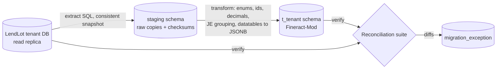
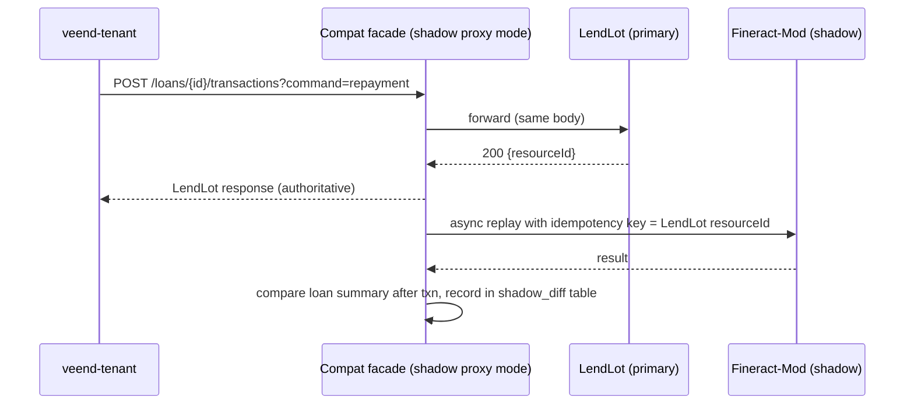

# D6 Migration and Integration Strategy

How veend-tenant moves from LendLot (Apache Fineract) to Fineract-Mod while **preserving historical financial records and accounting integrity**.

> [R] throughout unless tagged.

## 1. Principles

1. **Tenant by tenant.** Each lender migrates independently, with its own go/no-go. Pilot with the smallest active tenant.
2. **Fineract stays authoritative until reconciliation proves equality.** Fineract-Mod runs in shadow mode first.
3. **History is migrated, not summarised.** Every client, loan, schedule, transaction and journal entry is carried over with its original dates and ids mapped. Auditors can trace any balance back to its source.
4. **No silent fixes.** Discrepancies found during migration (e.g. DF-04 local write-offs, DF-06 orphan approvals) are resolved by **explicit, approved, dated correcting transactions** after the faithful load. They are never applied by altering history.
5. **Reversible until the rollback window closes.**

## 2. Pre-migration discovery on the live LendLot

From roadmap P-D. This must be completed before the ETL design is final.

| Item | Why |
|---|---|
| Fineract version and DB engine | Determines table shapes (e.g. `loan_transaction_strategy_code` vs id) and golden-fixture fidelity |
| Tenant list (`tenant_server_connections` / `tenants`) vs `Accesstokens` | Map each veend tenant to its Fineract tenant. Detect orphans |
| Products, charges, CoA, product mappings, payment types, datatables | Configuration migration |
| Custom reports (`stretchy_report` where `core_report=false`) | Compat parity |
| Scheduler jobs enabled and last runs (`job`, `job_run_history`) | Know whether accruals and COB ran historically |
| Maker-checker config (`m_permission.can_maker_checker`) | Governance parity |
| Data-quality scan: duplicate phones, unbalanced JE groups, loans 200 with local `closed`, loans 300 with local `isWriteOff`, negative balances | Exception plan |

## 3. Existing integration points and their replacements

| # | Current integration point ([V] D2) | Phase M0 (compat, no veend change) | Target replacement (native) | veend-tenant change |
|---|---|---|---|---|
| 1 | `new Lendlot(user, pass, baseUrl, tenantId, ref)` × 85 | Same; `lendlotBaseUrl` points at Fineract-Mod compat | `CbaClient` interface (`services/cba/index.js`) with LendLot and FineractMod implementations | M1 |
| 2 | `createBorrower` (search + create) | Compat C1/C2 with server-side dedupe | `cba.clients.ensure({externalId, mobileNo, …})` | M1 |
| 3 | `calculateLoan` | Compat L2 | `cba.schedules.calculate()` | M1 |
| 4 | `createLoan` → `approveLoan` → `getLoan` (11+ copies) | Compat L3/L4/L8 | `cba.loans.book({…, approve:true})`, one atomic call, `externalId = Loans._id` | M2 |
| 5 | `disburseLoan` after rail confirmation | Compat L5 | `cba.loans.disburse(id, {date: railValueDate, paymentType, externalRef: railRef})` | M2 |
| 6 | `undoApproval` + `rejectLoan` (errors swallowed) | Compat L6/L7 | `cba.loans.reject(id)`; errors surfaced | M2 |
| 7 | `makeRepayment` (date today, `paymentTypeId:1`) | Compat T1 + derived idempotency | `cba.loans.repay(id, {amount, valueDate, paymentType, externalRef})` | **M2 (fixes DF-01/02/12)** |
| 8 | `undoRepayment` (matched by amount) | Compat T2 | `cba.transactions.reverseByRef({paymentType, externalRef})` | M2 (fixes DF-05) |
| 9 | `updateLoanDatatable` (`remitaMandateReference`) | Compat datatable | `cba.loans.patchAttributes()` | M1 |
| 10 | Product and charge CRUD | Compat P1–P6 | `cba.products.*`, `cba.charges.*` with explicit GL mapping templates | M1 |
| 11 | Reports `ActiveLoansSummary`, `Aging Detail` (positional) | Compat R1–R3 | `cba.reports.run('portfolio.summary' \| 'portfolio.aging')` (named columns) | M4 |
| 12 | Local write-off (`isWriteOff`) | — | `cba.loans.writeOff(id, {date, reason})`; local flag set from the event | **M3 (fixes DF-04)** |
| 13 | Closure detection by polling (`getLoan`, Remita/IPPIS jobs) and local float math (`payoff`) | Unchanged | Webhooks `loan.closed`, `loan.repayment_posted`; local mirror updated from events | M4 |
| 14 | Arrears via the Aging report into `Cbaloanarrears` | Compat R3 | Events `loan.overdue`, `loan.delinquency_changed`; `cba.loans.delinquency()` | M4 |
| 15 | On-lending cross-tenant booking | Compat on the funding tenant (unchanged) | Inter-tenant funding (P9) | M5+ |

### veend-tenant change packages (to be scheduled with the veend-tenant team; **not part of this phase**)

| Package | Content | Risk | Can ship before Fineract-Mod? |
|---|---|---|---|
| **M1: client refactor** | Introduce a `CbaClient` interface; move `services/lendlot` behind it; stateless requests (fixes DS-05); delete dead methods (DS-12); redact headers in `APICalls` (DS-01); verify TLS (DS-03); no default credentials (DS-02) | Low | **Yes**: improves LendLot usage today |
| **M2: references and value dates** | Pass `externalId` on create, `externalId`/`externalRef` and the real value date on repayments and disbursements; replace the `Date.now()` references in `payoff` with provider references; fix the payoff payload mismatch (DS-06); composite booking | Medium | Partly: LendLot supports `transactionDate` and `externalId` |
| **M3: credit events to the CBA** | Write-off and recovery via the CBA; insurance claims as recoveries; Vida repayments posted (DF-09) | Medium (finance policy) | Yes, on LendLot too |
| **M4: event-driven mirror** | Webhook endpoint; replace polling jobs; read balances from the CBA instead of float-updating them | Medium | No |
| **M5: native API** | Switch `CbaClient` to native `/v1`; retire compat usage | Low | No |

## 4. API compatibility considerations

| Topic | Compat behaviour | Difference from LendLot (documented, intentional) |
|---|---|---|
| Duplicate repayment within 24 h with identical (loan, amount, date, note, paymentType) and no `externalId` | Returns the original transaction | LendLot would post twice. **Intentional (DF-02).** [A] Product to confirm no legitimate identical same-day payments exist without distinct notes |
| `editDisbursements` with a malformed body | 400 | LendLot accepted it and ignored it (DF-08) |
| `undoApproval`/`reject` on an invalid state | Proper 4xx | Same as LendLot; veend-tenant swallows it anyway until M2 |
| Repayment on a written-off loan | Routed to recovery (flag) | LendLot rejects it |
| Report column order | Identical | — |
| Dates | Identical `[y,m,d]` | — |
| Numeric precision | Fineract-style JSON numbers | — |
| Error envelope | Fineract-style | Error message texts may differ. veend-tenant does not parse them ([V], only logs them) |

## 5. Data migration

### 5.1 Approach

**Extract → stage → transform → load → verify**, per tenant, using a replica of the LendLot DB:

### 5.2 Mapping (abbreviated)

| Fineract source | Fineract-Mod target | Notes |
|---|---|---|
| `m_office`, `m_staff`, `m_payment_type` | `office`, `staff`, `payment_type` (+ `compat_payment_type_map`) | Keep the ids in `legacy_fineract_id` |
| `acc_gl_account`, `acc_product_mapping`, `acc_gl_closure`, `acc_gl_financial_activity_account` | `gl_account`, `product_gl_mapping` (roles via `financial_account_type`), `gl_closure`, `financial_activity_mapping` | Role ids 1–26 → role names per `AccountingConstants` ([V]) |
| `m_charge`, `m_product_loan*` | `charge`, `loan_product` + version 1 terms | |
| `m_client` + `userdata` | `client` (+ email, attributes) | BVN/NIN if present → encrypted |
| `m_loan` + `loandata` | `loan` (status, terms frozen from the loan row, not the product) | `account_no` preserved |
| `m_loan_repayment_schedule` | `loan_installment` | All components, including paid/waived/written-off/accrued |
| `m_loan_charge`, `m_loan_installment_charge`, `m_loan_charge_paid_by` | `loan_charge`, `loan_installment_charge`, `loan_txn_charge_paid` | |
| `m_loan_transaction` (incl. reversed) + `m_loan_transaction_repayment_schedule_mapping` | `loan_transaction` (`value_date = transaction_date`, `booking_date = submitted_on_date`), `loan_txn_allocation` | Reversed transactions are kept with `reversed=true` |
| `acc_gl_journal_entry` (single-sided, grouped by `transaction_id`) | `journal_entry` + `journal_line` | Unbalanced groups go to `migration_exception` |
| `m_portfolio_command_source` | `command_log` (status mapped, flagged `legacy=true`, excluded from the hash chain, which starts after migration) | Audit history preserved |
| `m_appuser`, `m_role`, `m_permission` | `app_user` (forced password reset or IdP), `role`, `role_permission` | Permission codes are the same vocabulary |
| `m_business_date` | `business_date` | |

`legacy_fineract_id` on every migrated entity keeps the compat facade answering with the **same ids** that veend-tenant stores (`Users.clientId`, `Loans.loanId`, `Loanproducts.externalId`, `Lendlotcharges.lendlotChargeId`, `VidaBnplLoans.cbaLoanId`). [R] Simplest option: **reuse Fineract ids as primary keys** for migrated rows and start the sequences above the max id. Then no id translation is needed anywhere.

### 5.3 Historical-record preservation rules

- Original dates, amounts, reversal flags and creators are preserved.
- The migrated GL is the **full journal history**, not an opening balance. The opening-balance fallback (a `MIGRATION_OPENING` entry at the cut-over date) is allowed only for tenants with Fineract history older than [A] N years, with finance approval.
- Every migrated row is checksummed (sha256 of canonical source values) and stored in `migration_audit`.

### 5.4 Post-load corrections (explicit, approved, dated)

| ID | Correction | Source evidence | Approval |
|---|---|---|---|
| T1 | Loans `200`/`100` in Fineract where veend-tenant shows `closed` after a failed disbursement (DF-06) → `reject` with the original failure date | `Loans.status='closed'`, `requeryCount≥3` | Ops |
| T2 | Loans ACTIVE in Fineract, `isWriteOff=true` in veend-tenant (DF-04) → `write-off` at `writeOffDate` | `Loans.isWriteOff`, `writeOffDate` | **Finance** |
| T3 | Insurance claims recorded locally → recovery repayments (payment type INSURANCE) | `isInsuranceClaimed`, `insuranceClaimedAmount` | Finance |
| T4 | Vida repayments acknowledged but never posted (DF-09) → repayments with their real value dates | Vida repayment logs | Finance + ops |
| T5 | Suspected double posts (same loan, amount and date, both with non-deterministic RequestIds) → reversal **only** after matching against rail statements | `APICalls`, rail statements | Finance |
| T6 | Concurrent top-up loans (DF-07): no correction. Documented as is | — | Product |

These are executed through the **normal command API** (with audit), after the faithful load and **before** the parallel-run diff baseline is taken, with LendLot receiving the same corrections. Both systems then start the parallel run from an identical state.

## 6. Financial reconciliation

Run after the load, daily during the parallel run, and at cut-over.

| Level | Check | Tolerance |
|---|---|---|
| Counts | Clients, loans by status, transactions by type, JE groups | Exact |
| Loan | For every loan: principal, interest, fee and penalty outstanding; total repaid; status; next due date; DPD | 0.00 |
| Schedule | For every installment: due and paid components | 0.00 |
| Recompute | Fineract-Mod recomputes each migrated loan from terms + transactions (replay engine). Result = migrated state | 0.00. Diffs are the definitive engine-parity test (ADR-009 step 2) |
| GL | Trial balance per account, office and currency at the cut-over date; P&L for the current period | 0.00 |
| Sub-ledger | Σ loan principal outstanding = LOAN_PORTFOLIO GL balance (per product mapping) | 0.00 |
| Clearing | Per-payment-type clearing balances vs rail settlement (post-cut-over only) | Explained |
| Reports | Compat report outputs equal LendLot's for the same date | Exact |

Every diff is logged to `migration_exception(tenant, level, entity, id, expected, actual, status, resolution, approved_by)`. **Go-live requires zero open exceptions**, or each one approved by finance as a known, documented difference.

## 7. Transaction consistency during transition

- **Shadow mode.** The facade can run as a **proxy**: LendLot stays primary, and Fineract-Mod receives the same writes asynchronously with deterministic keys. The `shadow_diff` table records any divergence. Reads always come from the primary.
- **Cut-over flips primary and shadow per tenant.** After the flip, LendLot keeps receiving shadow writes during the rollback window, so a rollback is possible without data loss.
- **Ordering.** The shadow replay preserves per-loan order (Bull group by loan id).
- **Failure in the shadow** never affects the primary response. It alerts, and a backfill is replayed from `APICalls`.

## 8. Cut-over procedure (per tenant)

| Step | Action | Owner | Duration |
|---|---|---|---|
| C-14d | Shadow mode on; daily reconciliation must be green for 14 consecutive days | Eng | 14 d |
| C-2d | Go/no-go #1: reconciliation, open exceptions = 0, runbooks ready, comms sent to lender ops | PO, finance | — |
| C-0 T-60m | Pause veend-tenant clock jobs for the tenant (`requeryDisbursement`, `pushRepayments`, repayment sweeps); drain kue queues for that tenant | Ops | 15 min |
| T-45m | Final reconciliation run (delta since last) | Eng | 20 min |
| T-25m | Go/no-go #2 | PO, finance | 5 min |
| T-20m | Flip the facade to Fineract-Mod primary for the tenant (proxy config); LendLot becomes shadow | Eng | 1 min |
| T-15m | Smoke tests: book a ₦1 test loan in the sandbox twin; read 20 random loans and compare; run the compat reports | QA | 15 min |
| T-0 | Resume the veend-tenant clock jobs | Ops | — |
| T+1d … T+30d | Hypercare: daily reconciliation (Fineract-Mod vs LendLot shadow); webhook DLQ = 0; COB green | Eng | 30 d |
| T+30d | Close the rollback window: stop shadow writes to LendLot; LendLot becomes read-only; archive the DB | PO, finance | — |

The **downtime** window for collections is about 60 minutes per tenant. Choose a low-traffic window, not on a payroll deduction day (Remita/IPPIS cycles) [A: confirm the payroll calendar].

## 9. Rollback strategy

| Situation | Action |
|---|---|
| Before C-0 (shadow) | Disable shadow; nothing changes for veend-tenant |
| During the cut-over window (before T-0) | Flip the proxy back to LendLot primary; discard Fineract-Mod writes for the window (none were authoritative) |
| Within the 30-day window | Flip back to LendLot primary. LendLot has every write (shadow), so no data loss. Reconcile, then investigate |
| After 30 days | Rollback means a reverse migration (Fineract-Mod → Fineract), not supported by default. The decision point is at T+30d |

Rollback triggers: any loan-level diff > ₦0 not explained within 24 h; trial balance ≠ 0; COB failure two days running; a P1 security finding; or a webhook backlog > 2 h affecting collections.

## 10. Validation procedures (acceptance for each tenant)

1. Reconciliation suite green (§6), and exceptions closed or approved.
2. Compat contract corpus (≥ 200 per endpoint) green against the tenant's migrated data.
3. Business smoke scenarios executed in staging with a copy of the tenant's data: eligibility quote, book, disburse confirm, Remita deduction posting, card repayment webhook, reversal, payoff, write-off (M3), dashboard reports.
4. Finance sign-off on the trial balance and portfolio report at T-25m.
4a. The recovery-team UAT pack (roadmap P5) executed on the tenant's migrated data, with evidence retained: transaction reference, before/after balances, GL entries, report output, exception log.
5. Lender operations sign-off (dashboard figures unchanged).

## 11. Backward compatibility guarantees

- veend-tenant code at the cut-over commit works **unchanged** against the facade (M0).
- Ids veend-tenant stores keep resolving (§5.2).
- The facade is supported for at least **6 months after the last tenant cut-over**. Retirement requires zero compat calls for 30 days (FR-INT-08 metrics).

## 12. Giro fixed-deposit migration

Scope: the investor fixed-deposit book run by `bill-payment-portal` (Giro). Current state: [D1.4](01-assessment/bill-payment-portal.md), [D2.7](02-current-state/fixed-deposits-current-state.md). Target: [fixed-deposits](05-modules/fixed-deposits.md).

### 12.1 Why this differs from the lending migration

For lending, Fineract is the source of truth, and we migrate its ledger faithfully. For **current (G2) fixed deposits there is no ledger to migrate**. The truth lives in:
- Mongo `Accounts` (terms, `interestPayouts[]`, flags)
- `Primelogs` (tranches and deployment costs)
- Giro SQL `Balances` (DOUBLE)
- arithmetic performed at read time

So the migration **constructs** the deposit ledger from operational records and agrees it with finance. That process is closer to a first-time booking than to a data copy.

### 12.2 Source to target mapping

| Generation | Source | Target |
|---|---|---|
| Products | Giro-tenant `m_savings_product` rows used for FDs (ids from `CBAFixedSavingsProductId` / `CBAOnlendingActiveProductIds`) | `deposit_product` (+ version 1). Tenure unit per D9; rate from `nominal_annual_interest_rate` |
| Investor clients | Giro-tenant `m_client` (ids in Giro `Users.clientId`) | `client` in the `giro` tenant (`legacy_fineract_id` = Fineract id, so Giro's `clientId` keeps resolving) |
| G1 FD accounts (non-V3, not CBA-exclusive) | Giro-tenant `m_savings_account` + `m_savings_account_transaction` (deposits, interest postings, withdrawals) | `deposit_account` + `deposit_transaction` (faithful copy, like loans in §5), `legacy_fineract_id` = savings id |
| G2 FD accounts (CBA-exclusive) | Mongo `Accounts` (`isOnlending`, `additionalInfo.otherAdditionalInfo`, `interestPayouts`, `onlendingWithdrawalFrequency`), `Primelogs` (each `onlenderPurchaseLog.cost`, `createdAt`) | `deposit_account` with **product version `LEGACY_GIRO_DAILY_ROUNDED`**, `accrual_start = DEPLOYMENT_DATE`. `deposit_tranche` per Primelog. Historical deposit transactions synthesised at their purchase dates. Accrual posted as one catch-up entry to the cut-over date. Paid interest from `interestPayouts[]` with `paymentReference` as `externalRef` |
| Deployments | `Primelogs.edenCbaLoanId`, `Accounts.loanIds[]` (`<loanId>_<purchaseId>`) | `deposit_deployment` (target tenant = the lending-to-lender tenant, `target_loan_ref`) |
| Expired, unrefunded accounts | `hasExpired:true`, balance > 0 | `deposit_account` status 400 with `refundDue` (an ops worklist) |
| `disbursement_failed` Primelogs | `status:'disbursement_failed'` | `deposit_deployment` status `PENDING`, flagged for ops (FD-09) |
| The FD savings account in the Giro Fineract tenant for G2 (zero balance) | — | Not migrated. Linked via `deposit_account.legacy_fineract_id` for compat id continuity |

### 12.3 Reconciliation (per account, exact)

| Check | Expected |
|---|---|
| Deposits | Σ tranches = Σ `Primelogs.onlenderPurchaseLog.cost` (G2) or the Fineract deposits (G1) |
| Earnings to date | Fineract-Mod legacy calculator = `aggregatePrimeOnlendData(...).stats.totalEarnings` computed on the same date |
| Paid interest | = Σ `interestPayouts.paidAmount` (completed) |
| Payable at maturity | = Giro's `deposits + earnings − paid` at maturity |
| Maturity date | = Giro's `createdAt + tenure` (as Giro computes it) for in-flight accounts. Any FD-05 differences are listed and approved |
| Book-level | Σ SAVINGS_CONTROL = Σ deposits outstanding; Σ INTEREST_PAYABLE = Σ (earnings − paid); the treasury on-lending receivable = Σ deployments not yet returned [A: depends on the D9 balance-sheet decision] |

Policy changes (native SIMPLE mode, rate locking, calendar quarters, funding-date accrual) apply **only to deposits opened after cut-over**. In-flight deposits keep Giro's arithmetic until maturity, so no investor sees a changed figure.

### 12.4 Giro change packages (scheduled with the Giro team; not part of this phase)

| Package | Content | Can ship before Fineract-Mod? |
|---|---|---|
| **G1: client hygiene** | Stateless client; redact headers in logs; remove secret defaults from config (FD-11); delete dead methods (`deposit`, `accountTransfer`) | Yes |
| **G2: CBA-reported money** | Report each FD funding, deployment and payout to the CBA with `externalRef` (`/v1/deposit-accounts/{id}/deposits`, `/deployments`, `/payouts/{n}/settlement`), instead of keeping them only in Primelogs | No (needs P5-D) |
| **G3: CBA-driven schedule** | Replace `dailyCheckLoanAccounts`/`checkLoanAccount`/`postInterest*` with the CBA payout worklist (`GET /v1/deposit-payouts?status=DUE`) and `deposit.*` webhooks. Giro keeps executing transfers, notifications, partner `webhookURL` callbacks and referral commissions | No |
| G4 (optional, per D9) | Wallet ledger to the CBA | No (P9) |

### 12.5 Cut-over

1. Pause the Giro FD jobs: `dailyCheckLoanAccounts`, `postInterestOnAccounts`, `postInterestOnUserAccounts`, `processDraftOnlendingFunds`, `retryPendingOnlendingDisburseLoan`. Block FD creation for about 30 minutes.
2. Load the final delta: new tranches and payouts since the rehearsal.
3. Reconcile (§12.3). Finance signs the opening deposit liability.
4. Switch Giro to Fineract-Mod: base URL for compat calls, then enable packages G2/G3 by flag.
5. Resume jobs in their CBA-driven form.

**Rollback:** until the first CBA-computed payout is settled, Giro can revert to its own computation, because no Giro data was mutated. After that point, a rollback requires replaying the settled payouts into Giro's `interestPayouts`.

## 13. BankOne (Pettysave MFB) migration

Scope: moving a licensed MFB from the BankOne vendor CBS to Fineract-Mod (ADR-010). Evidence of the current state: [input review](09-input-reviews/recovery-team-2026-10.md).

### 13.1 Principles specific to a bank migration

- **Source of truth is the BankOne database or API, not report exports.** The exported TB does not balance, and the P&L period label is suspect (R-DAT-02).
- **Fix regulatory data before migrating it.** The CBN 761 vs PAR classification discrepancy (~₦100m potential provision gap) must be resolved by Pettysave compliance and finance first. Fineract-Mod then recomputes classification from loan-level DPD and must match the corrected figures.
- **Customer-facing continuity**: NUBANs, card PANs (via processor), mandates and standing instructions keep working. Statements show history across the cut-over.

### 13.2 Data scope and mapping

| BankOne domain | Fineract-Mod target | Notes |
|---|---|---|
| Branches, users, roles, tellers, vaults | office (FR-ORG-07), app_user/role, teller, vault | User credentials are not migrated (re-enrolment/IdP) |
| CoA, account categories, entry codes | gl_account + categories (FR-ACC-10), entry_code | GL codes preserved (e.g. 10080006 Vault [V TB format]) |
| Customers (individual/corporate), KYC, risk | client (FR-CLI-09..11) | BVN/NIN encrypted; KYC tier recomputed and reviewed |
| Savings, current, special, term, target savings | casa_account, deposit_account, commitment_plan | Balances, holds, interest accrued, dormancy; NUBAN kept |
| Loans (887 at 30-Sep-2026) with schedules and transactions | loan, loan_installment, loan_transaction | Tags from the PAR (officer, sector, lending model, MDA/IPPIS, restructured flags); collateral and guarantors → collateral-guarantors |
| Provisions, interest in suspense | provisioning_entry, IIS balances | Opening position as approved by finance after the 761 fix |
| Fixed assets, prepayments | fixed_asset, amortization_schedule | From BankOne Fixed Assets / Amortization menus or finance register |
| Shareholders, deposits for shares | shareholder, share_holding | Register reconciled to ₦200m ordinary + ₦92m deposit for shares [V BS] |
| GL balances and history | journal_entry/line (history, or opening balances per policy) | Full history if extractable; otherwise opening balances at cut-over plus BankOne reports archived |

### 13.3 Reconciliation (cut-over date)

Trial balance by GL code (exact) · balance sheet and CBN MMFBR 300 regenerated · loan book: per loan principal not-yet-due/past-due, interest, DPD, classification (PAR report) · per CASA/term account ledger and available balances · teller and vault positions · Σ customer balances = deposit control GLs · CBN returns 761/763/201 regenerated and compared.

### 13.4 Cut-over

A weekend cut-over: freeze BankOne postings → final extract → load → reconcile → switch NIBSS routing, card processor account mapping, USSD and channels → smoke tests (teller cash, NIP in/out, loan repayment, statements) → go-live. BankOne stays read-only for the agreed retention period. Notify the CBN as required [A]. Rollback: switch channels back to BankOne if go-live criteria fail within the window (postings during the window are replayed).
